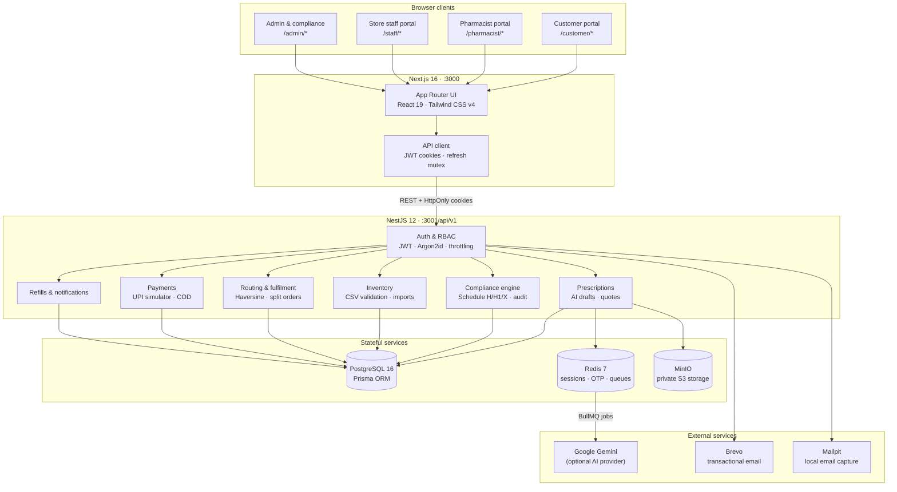
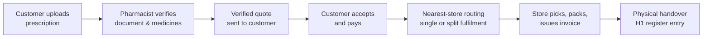

# Pharmacy Management Platform

A prescription-first, multi-store pharmacy management platform built as a TypeScript monorepo. It brings customer ordering, pharmacist clinical verification, store fulfilment, inventory operations, and Indian drug-schedule compliance into one auditable system.

---

## Overview

The platform is organised as four role-specific portals backed by a single REST API:

| Portal             | Path          | Users                                                                  |
| ------------------ | ------------- | ---------------------------------------------------------------------- |
| Customer           | `/customer`   | Medicine catalogue, prescription upload, quotes, orders, refills       |
| Pharmacist         | `/pharmacist` | Clinical review, AI draft comparison, compliance sign-off, fulfilment  |
| Store Staff        | `/staff`      | Store inventory, CSV stock imports, pick/pack/handover                 |
| Admin & Compliance | `/admin`      | Catalogue, inventory, routing, analytics, statutory rules, H1 register |

The core workflow is intentionally **prescription-first**: an uploaded prescription is reviewed by a pharmacist and quoted before the customer can pay, after which orders are routed to the nearest store (or split across stores) for fulfilment.

---

## Features

### Customer portal

- Searchable medicine catalogue with availability and pricing
- Prescription upload (image/PDF) with private object storage and signed URLs
- Pharmacist-verified quotation review before payment
- Persistent cart, saved delivery addresses, and family member profiles
- UPI simulation and Cash-on-Delivery checkout
- Order tracking, invoices, cancellation, and delivery handover status
- Automated refill reminders and one-tap reorder
- In-app notifications

### Pharmacist portal

- Prescription review queue with AI extraction shown as a draft only
- Side-by-side scanned document and catalogue match comparison
- Structured dosage confirmation and line-item approve/reject
- Schedule H / H1 regulatory checks with fail-closed behaviour
- Generic substitution proposals with customer consent
- Quotation generation and fulfilment queue
- Schedule H1 register access

### Store staff portal

- Store-scoped live inventory and reorder levels
- Daily CSV stock snapshots with schema validation before any write
- Atomic imports with row-level errors and rollback on failure
- Picking, packing, invoicing, and physical handover

### Admin and compliance portal

- Operations dashboard and analytics for orders, stores, verification, refills, and fulfilment
- Medicine catalogue CRUD and schedule classification
- Multi-store inventory oversight, imports, and stock reservations
- Review assignment and reallocation
- Versioned compliance rule sets and decision history
- Immutable H1 register, audit logs, invoices, and COD collection records

### Platform capabilities

- Four roles: `CUSTOMER`, `PHARMACIST`, `STORE_STAFF`, `ADMIN`
- Argon2id password hashing, short-lived JWT access tokens, refresh tokens, HttpOnly cookies
- Redis-backed sessions and OTP challenges
- Private S3-compatible storage with short-lived presigned URLs
- Nearest-store routing using the Haversine formula, with multi-store split fulfilment under one bundle payment
- Asynchronous prescription extraction via BullMQ with a deterministic mock provider or Google Gemini
- Append-only audit logging for sensitive actions
- Health checks, request throttling, global validation, and Swagger/OpenAPI docs
- Vitest unit, integration, and E2E suites with deterministic fixtures

---

## Architecture

### System diagram



### Order lifecycle



A prescription never creates an order until it has been clinically reviewed, quoted, and paid for. Stock is reserved at approval time and consumed only at physical handover.

---

## Technology stack

| Layer            | Technology                                                                      |
| ---------------- | ------------------------------------------------------------------------------- |
| Monorepo         | pnpm workspaces                                                                 |
| Frontend         | Next.js 16 (App Router, Turbopack), React 19, Tailwind CSS v4, Radix UI, Lucide |
| Backend          | NestJS 12, REST, Swagger/OpenAPI                                                |
| Database         | PostgreSQL 16, Prisma ORM 6                                                     |
| Cache and queues | Redis 7, ioredis, BullMQ                                                        |
| Object storage   | MinIO (S3-compatible, private buckets, presigned URLs)                          |
| Email            | Brevo (production), Mailpit (local)                                             |
| AI               | Deterministic mock provider or Google Gemini via LangChain                      |
| Testing          | Vitest 5, Supertest, React Testing Library                                      |
| Tooling          | Oxlint, Prettier, TypeScript                                                    |

---

## Requirements

### Local development

| Requirement    | Version                                    |
| -------------- | ------------------------------------------ |
| Node.js        | 20.9 or newer (Node 22/24 LTS recommended) |
| pnpm           | 12.16.1 (via Corepack)                     |
| Docker Engine  | 24 or newer                                |
| Docker Compose | v2                                         |
| RAM            | 8 GB recommended                           |
| Disk           | 5 GB free                                  |

### Optional credentials

| Variable         | Purpose                                                                     |
| ---------------- | --------------------------------------------------------------------------- |
| `GEMINI_API_KEY` | Enables real AI prescription extraction (`PRESCRIPTION_AI_PROVIDER=gemini`) |
| `BREVO_API_KEY`  | Enables transactional email in production (`MAIL_PROVIDER=brevo`)           |

Without these, the platform runs fully offline using the deterministic mock AI provider and Mailpit.

### Local ports

| Port            | Service               |
| --------------- | --------------------- |
| `3000`          | Next.js web           |
| `3001`          | NestJS API            |
| `5432`          | PostgreSQL            |
| `6379`          | Redis                 |
| `9000` / `9001` | MinIO API / console   |
| `1025` / `8025` | Mailpit SMTP / web UI |

---

## Setup

### 1. Install Node and pnpm

```bash
corepack enable
corepack prepare pnpm@12.16.1 --activate
node --version   # 20.9+
pnpm --version   # 12.16.1
```

### 2. Install dependencies

```bash
pnpm install
```

### 3. Configure environment

```bash
cp .env.example .env
```

The defaults work for local development. Update `GEMINI_API_KEY` or `BREVO_API_KEY` only if you want the real providers.

### 4. Start infrastructure

```bash
pnpm infra:up
```

This starts PostgreSQL, Redis, MinIO, and Mailpit with health checks and named volumes.

### 5. Apply migrations and seed demo data

```bash
pnpm --filter @pharmacy/api prisma:migrate
pnpm db:seed
```

### 6. Start the applications

```bash
pnpm dev
```

| URL                                   | Service             |
| ------------------------------------- | ------------------- |
| `http://localhost:3000`               | Web portal selector |
| `http://localhost:3001/api/v1/health` | API health          |
| `http://localhost:3001/api/docs`      | Swagger UI          |
| `http://localhost:8025`               | Mailpit inbox       |

### 7. Stop infrastructure

```bash
pnpm infra:down
```

For production deployment, see [deployment.md](deployment.md).

---

## Commands

### Development

| Command        | Description                      |
| -------------- | -------------------------------- |
| `pnpm dev`     | Run API and web together         |
| `pnpm dev:api` | Run the NestJS API in watch mode |
| `pnpm dev:web` | Run the Next.js web app          |

### Build and quality

| Command             | Description                             |
| ------------------- | --------------------------------------- |
| `pnpm build`        | Build shared packages, API, and web     |
| `pnpm lint`         | Run Oxlint across API and web           |
| `pnpm lint:fix`     | Apply safe lint fixes                   |
| `pnpm typecheck`    | Run `tsc --noEmit` across the workspace |
| `pnpm format`       | Format files with Prettier              |
| `pnpm format:check` | Verify formatting                       |

### Tests

| Command                 | Description                          |
| ----------------------- | ------------------------------------ |
| `pnpm test`             | Run unit, web, and integration tests |
| `pnpm test:unit`        | Run API and web unit tests           |
| `pnpm test:integration` | Run API integration/E2E suites       |
| `pnpm test:e2e`         | Alias for integration suites         |
| `pnpm test:coverage`    | Generate API coverage report         |

Integration tests expect the Docker services to be running and the database to be seeded.

### Infrastructure and database

| Command                                       | Description                               |
| --------------------------------------------- | ----------------------------------------- |
| `pnpm infra:up`                               | Start PostgreSQL, Redis, MinIO, Mailpit   |
| `pnpm infra:down`                             | Stop infrastructure containers            |
| `pnpm infra:logs`                             | Follow infrastructure logs                |
| `pnpm db:seed`                                | Seed demo stores, catalogue, and accounts |
| `pnpm --filter @pharmacy/api prisma:generate` | Regenerate the Prisma client              |
| `pnpm --filter @pharmacy/api prisma:migrate`  | Create/apply development migrations       |
| `pnpm --filter @pharmacy/api prisma:seed`     | Run the Prisma seed script directly       |

In production, use `prisma migrate deploy` rather than `prisma migrate dev`, and never run the demo seed. See [deployment.md](deployment.md).

---

## Limitations

### Simulated integrations

- **AI extraction** defaults to a deterministic mock provider. Gemini can be enabled, but AI output is always a draft and never approves prescriptions or changes drug schedules.
- **Payments** use an in-app UPI simulator and COD flow. No Razorpay/Cashfree webhooks or HMAC verification are implemented.
- **SMS OTP** has no gateway integration. Customer OTP is delivered by email (Brevo or Mailpit). Demo OTP bypass is for local use only and must be disabled in production.

### Fulfilment and routing

- Store distance uses the Haversine formula only. There is no live road-distance, traffic, or delivery-partner polygon integration.
- Multi-store split fulfilment assigns items greedily to the nearest stores; it does not optimise for shipping cost or consolidation.
- BullMQ workers run inside the API process. Scale vertically or separate workers before running many API replicas.

### Infrastructure and operations

- MinIO is suitable for local and single-server deployments. Production should use managed S3/GCS with KMS encryption and lifecycle policies.
- Presigned prescription URLs are generated from `MINIO_ENDPOINT`. That endpoint must be reachable by the browser, or prescription previews will fail.
- The repository's Compose file provisions backing infrastructure only; the API and web app run as host processes. High availability, autoscaling, centralized logging, metrics, and automated backups require additional infrastructure.
- The demo seed creates accounts with known credentials and realistic demo data. Never run it against a production database.

### Compliance

- The compliance engine encodes a configurable technical policy for Indian drug schedules. It is not a substitute for legal review, licensed pharmacist oversight, or state-specific regulatory requirements.
- Regulatory classifications and rule sets must be reviewed and maintained by a qualified compliance officer before real-world dispensing.

---

## Demo accounts

After seeding, the following accounts are available. All use the password `DemoPassword123!`; customer accounts use demo OTP `123456`.

| Role                  | Portal              | Email                            |
| --------------------- | ------------------- | -------------------------------- |
| Customer              | `/customer/login`   | `customer@example.com`           |
| Customer              | `/customer/login`   | `customer2@example.com`          |
| Pharmacist            | `/pharmacist/login` | `pharmacist@example.com`         |
| Store staff (KOL-001) | `/staff/login`      | `staff.saltlake@example.com`     |
| Store staff (HOW-001) | `/staff/login`      | `staff.howrah@example.com`       |
| Store staff (SOU-001) | `/staff/login`      | `staff.southkolkata@example.com` |
| Admin                 | `/admin/login`      | `admin@example.com`              |
| Compliance admin      | `/admin/login`      | `compliance@example.com`         |

Demo stores:

- `KOL-001` — Salt Lake Store, Kolkata
- `HOW-001` — Howrah Maidan Store, Howrah
- `SOU-001` — South Kolkata Store, Kolkata

See [docs/demo-guide.md](docs/demo-guide.md) for the full demonstration walkthrough.

---

## Documentation

- [Deployment guide](deployment.md)
- [System architecture](docs/architecture.md)
- [Demo guide](docs/demo-guide.md)
- [Testing strategy](docs/testing.md)
- [Security review](docs/security-review.md)
- [Performance report](docs/performance-report.md)
- [System audit](docs/system-audit.md)
- [Known limitations](docs/known-limitations.md)
