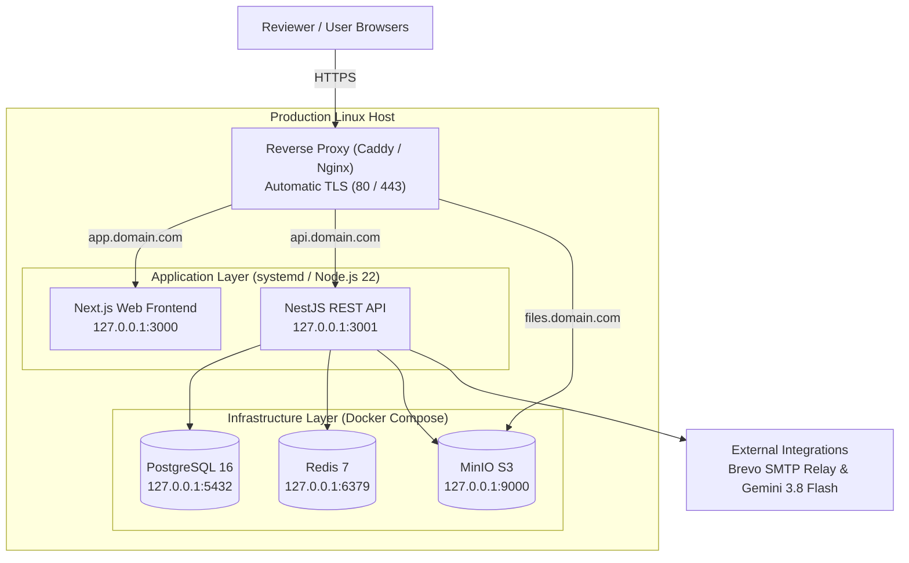

# Deployment & Execution Guide

**Project Repository**: [https://github.com/Anujanthwal-dotcom/assignment-isocode-labs](https://github.com/Anujanthwal-dotcom/assignment-isocode-labs)  
**Target Audience**: Isocode Evaluation & Review Team  

---

## Table of Contents

1. [How to Run It Locally (Step-by-Step)](#1-how-to-run-it-locally-step-by-step)
2. [How It Is Deployed & Required Environment Variables](#2-how-it-is-deployed--required-environment-variables)
3. [Demo Login Details for the Reviewer](#3-demo-login-details-for-the-reviewer)
4. [Guided Reviewer Scenarios](#4-guided-reviewer-scenarios)

---

## 1. How to Run It Locally (Step-by-Step)

Follow these steps to run the complete multi-portal pharmacy platform on your local machine using Docker Compose and Node.js.

### 1.1 Prerequisites

Ensure the following tools are installed on your workstation:
- **Node.js**: `v22.x` or higher
- **pnpm**: `v12.16.1` (or enable via `corepack enable && corepack prepare pnpm@12.16.1 --activate`)
- **Docker Engine & Docker Compose**: `v24+` / Compose `v2+`
- **Git**

---

### 1.2 Step-by-Step Execution

#### Step 1: Clone Repository and Install Dependencies
```bash
git clone https://github.com/Anujanthwal-dotcom/assignment-isocode-labs.git
cd assignment-isocode-labs

# Install all monorepo workspace dependencies
pnpm install --frozen-lockfile
```

#### Step 2: Configure Environment Variables
Copy the provided environment template into `.env`:
```bash
cp .env.example .env
```
*(The default configuration in `.env.example` is pre-configured with local credentials, mock AI extraction, and demo OTP for seamless local evaluation).*

#### Step 3: Start Infrastructure Services
Boot the containerized PostgreSQL, Redis, and MinIO S3 instances:
```bash
pnpm infra:up
```

Verify that all three containers are healthy:
```bash
docker compose --env-file .env -f infrastructure/docker/docker-compose.yml ps
```
> [!NOTE]
> Services running:
> - **PostgreSQL 16**: `localhost:5432`
> - **Redis 7**: `localhost:6379`
> - **MinIO S3**: `localhost:9000` (API) & `localhost:9001` (Web Console)

#### Step 4: Run Migrations and Seed Demo Data
Apply the Prisma database migrations and load the complete evaluation dataset (stores, medicines, prescriptions, demo users, inventory balances, and compliance rules):
```bash
# Generate Prisma Client
pnpm --filter @pharmacy/api exec prisma generate

# Apply migrations
pnpm --filter @pharmacy/api exec prisma migrate deploy

# Seed demonstration accounts, catalogues, and scenario prescriptions
pnpm db:seed
```

#### Step 5: Start Application Development Servers
Launch both the **NestJS API** and the **Next.js Web Frontend** concurrently with a single command:
```bash
pnpm dev
```

This starts:
- **Web Application (Next.js 16)**: [http://localhost:3000](http://localhost:3000)
- **REST API Gateway (NestJS 12)**: [http://localhost:3001](http://localhost:3001)

#### Step 6: Verify Service Health
Check that the API and background dependencies are responding:
```bash
curl -fsS http://localhost:3001/api/v1/health
```
Expected response:
```json
{
  "status": "ok",
  "service": "pharmacy-api",
  "dependencies": {
    "database": "ok",
    "redis": "ok"
  }
}
```

Interactive OpenAPI / Swagger documentation is accessible at:
- **Swagger UI**: [http://localhost:3001/api/docs](http://localhost:3001/api/docs)

---

## 2. How It Is Deployed & Required Environment Variables

### 2.1 Production Deployment Topology

The platform is designed to be deployed on a standard cloud virtual machine (Ubuntu 22.04/24.04 LTS VPS) or container orchestrator:



#### Production Deployment Lifecycle:
1. **Infrastructure Isolation**: PostgreSQL, Redis, and MinIO run containerized via Docker Compose, binding ports strictly to `127.0.0.1` so that data stores are shielded from public internet exposure.
2. **Reverse Proxy & TLS**: A reverse proxy (such as Caddy or Nginx) routes inbound HTTPS requests across three unified subdomains:
   - `app.<domain>` $\to$ Next.js Web (`:3000`)
   - `api.<domain>` $\to$ NestJS API (`:3001`)
   - `files.<domain>` $\to$ MinIO private presigned URL endpoint (`:9000`)
3. **Application Daemons**: The compiled Next.js application (`pnpm build`) and NestJS server (`nest build`) run as supervised background services using `systemd` with automatic restarts and journald logging.
4. **Database Migrations**: Database schema updates are applied forward-only during release cutovers using `prisma migrate deploy`.

---

### 2.2 Required Environment Variables (Names Only)

Below is the complete inventory of environment variables required to configure and run the system. In adherence to security standards, **only variable names and descriptions are listed—no values are included**.

| Variable Name | Configuration Scope | Purpose & Description |
| :--- | :--- | :--- |
| `NODE_ENV` | Application Runtime | Defines application environment (`development` or `production`) |
| `PORT` | API Backend | Port number for the NestJS HTTP server |
| `CORS_ORIGIN` | API Backend | Permitted client origin URL for CORS policy |
| `WEB_ORIGIN` | API Backend | Canonical web application origin for authentication redirects |
| `API_ORIGIN` | API Backend | Public URL of the backend API |
| `NEXT_PUBLIC_API_URL` | Web Frontend | Client-side API URL inlined at Next.js build time |
| `POSTGRES_USER` | Database / Infrastructure | PostgreSQL administrative username |
| `POSTGRES_PASSWORD` | Database / Infrastructure | PostgreSQL user password |
| `POSTGRES_DB` | Database / Infrastructure | Target database name |
| `POSTGRES_PORT` | Database / Infrastructure | Host port mapping for PostgreSQL |
| `DATABASE_URL` | API Backend (Prisma) | Full PostgreSQL connection string with authentication credentials |
| `REDIS_HOST` | Cache / BullMQ | Hostname or IP of the Redis server |
| `REDIS_PORT` | Cache / BullMQ | Port number of the Redis server |
| `REDIS_PASSWORD` | Cache / BullMQ | Authentication password for Redis |
| `REDIS_URL` | Cache / BullMQ | Full Redis connection URI |
| `MINIO_ROOT_USER` | Object Storage | Administrative access key for MinIO S3 |
| `MINIO_ROOT_PASSWORD` | Object Storage | Administrative secret key for MinIO S3 |
| `MINIO_ENDPOINT` | Object Storage | Hostname for MinIO S3 document access |
| `MINIO_PORT` | Object Storage | Port for MinIO S3 API |
| `MINIO_CONSOLE_PORT` | Object Storage | Web console port for MinIO management |
| `MINIO_USE_SSL` | Object Storage | Flag specifying whether to use HTTPS/SSL for S3 connections |
| `MINIO_BUCKET_PRESCRIPTIONS`| Object Storage | Private bucket name designated for prescription scans |
| `MINIO_SERVER_SIDE_ENCRYPTION` | Object Storage | Encryption mode for medical documents (`AES256` or `aws:kms`) |
| `MINIO_KMS_KEY_ID` | Object Storage | Key identifier when using KMS encryption |
| `MINIO_KMS_SECRET_KEY` | Object Storage | Secret key when using standalone MinIO encryption |
| `JWT_ACCESS_SECRET` | Authentication | Cryptographic secret for signing short-lived access JWTs |
| `JWT_REFRESH_SECRET` | Authentication | Cryptographic secret for signing long-lived refresh JWTs |
| `JWT_ISSUER` | Authentication | JWT issuer verification string |
| `JWT_AUDIENCE` | Authentication | JWT audience verification string |
| `ACCESS_TOKEN_TTL` | Authentication | Duration before access token expiration |
| `REFRESH_TOKEN_TTL` | Authentication | Duration before refresh token expiration |
| `REFRESH_TOKEN_TTL_SECONDS`| Authentication | Numeric TTL in seconds for Redis session store |
| `MAIL_PROVIDER` | Email Notifications | Email dispatch driver (`brevo` or mock) |
| `BREVO_SMTP_HOST` | Email Notifications | Hostname for Brevo SMTP relay |
| `BREVO_SMTP_PORT` | Email Notifications | Port for Brevo SMTP relay |
| `BREVO_SMTP_USER` | Email Notifications | Authenticated SMTP account username |
| `BREVO_SMTP_KEY` | Email Notifications | Authenticated SMTP account key/password |
| `BREVO_API_KEY` | Email Notifications | API key for Brevo transactional email REST endpoints |
| `MAIL_FROM_EMAIL` | Email Notifications | Sender email address for outgoing system notifications |
| `MAIL_FROM_NAME` | Email Notifications | Display name for outgoing system notifications |
| `DEMO_OTP_ENABLED` | Demo / Testing | Enables deterministic OTP bypass for evaluation |
| `DEMO_OTP_CODE` | Demo / Testing | Fixed numeric passcode for demo login verification |
| `DEMO_OTP_EMAILS` | Demo / Testing | Comma-separated list of test emails eligible for demo OTP bypass |
| `PRESCRIPTION_AI_PROVIDER` | AI Vision Subsystem | Active AI extraction engine (`mock` or `gemini`) |
| `GEMINI_API_KEY` | AI Vision Subsystem | API key for Google Gemini multimodal vision model |
| `GEMINI_MODEL` | AI Vision Subsystem | Model name for OCR extraction (`gemini-3.8-flash`) |
| `PRESCRIPTION_AI_TIMEOUT_MS`| AI Vision Subsystem | Maximum execution duration before fallback |
| `PRESCRIPTION_AI_MAX_RETRIES`| AI Vision Subsystem | Retry threshold for AI vision processing jobs |

---

## 3. Demo Login Details for the Reviewer

The platform comes pre-seeded with dedicated demonstration accounts covering all four specialized persona portals.

### 3.1 Portal Access Matrix

| Portal Role | Target Portal URL | Description |
| :--- | :--- | :--- |
| **Portal Hub / Landing** | [http://localhost:3000](http://localhost:3000) | Landing page with direct quick-links to all 4 portals |
| **Customer Portal** | [http://localhost:3000/customer](http://localhost:3000/customer) | Chronic 1-tap reordering, prescription uploads, family profiles |
| **Pharmacist Terminal** | [http://localhost:3000/pharmacist](http://localhost:3000/pharmacist) | Side-by-side prescription verification queue, AI draft review & quoting |
| **Store Staff Hub** | [http://localhost:3000/staff](http://localhost:3000/staff) | Daily CSV stock import, digital picking & packing checklists, courier handover |
| **Admin Operations** | [http://localhost:3000/admin](http://localhost:3000/admin) | Central multi-store command, inventory telemetry, statutory audit register |

---

### 3.2 Pre-Seeded Demonstration Accounts

> [!TIP]
> **Universal Demo Password**: All demo accounts share the password:  
> `DemoPassword123!`  
> *(Customer OTP verification code: `123456`)*

| Persona / Role | Email | Password / OTP | Associated Scope / Location |
| :--- | :--- | :--- | :--- |
| **Customer (Primary)** | `customer@example.com` | `DemoPassword123!` *(or OTP: `123456`)* | Debasish Ghosh (Salt Lake, Kolkata) with pre-linked mother Maya Ghosh |
| **Customer (Secondary)** | `customer2@example.com` | `DemoPassword123!` *(or OTP: `123456`)* | Rina Sen (Howrah Maidan) with Schedule H1 prescription history |
| **Pharmacist** | `pharmacist@example.com` | `DemoPassword123!` | Registered Pharmacist assigned to Salt Lake Branch (`KOL-001`) |
| **Store Staff (Salt Lake)** | `staff.saltlake@example.com` | `DemoPassword123!` | Salt Lake Store (`KOL-001`) — Inventory & Dispatch Lead |
| **Store Staff (Howrah)** | `staff.howrah@example.com` | `DemoPassword123!` | Howrah Maidan Store (`HOW-001`) — Store Stock Associate |
| **Store Staff (South Kolkata)** | `staff.southkolkata@example.com` | `DemoPassword123!` | South Kolkata Store (`SOU-001`) — Store Stock Associate |
| **Central Admin** | `admin@example.com` | `DemoPassword123!` | Operations Head — Chain-wide 46-store visibility |
| **Compliance Officer** | `compliance@example.com` | `DemoPassword123!` | Statutory Auditor — Schedule H1 register & DPDP audit logs |

---

## 4. Guided Reviewer Scenarios

To evaluate the complete end-to-end functionality of the platform, the following four test walkthroughs are recommended:

### Scenario 1: Customer 1-Minute Chronic Reordering
1. Navigate to [http://localhost:3000/customer/login](http://localhost:3000/customer/login).
2. Sign in with `customer@example.com` using password `DemoPassword123!` (or email OTP `123456`).
3. On the dashboard, observe the **1-Tap Refill Banner** showing Maya Ghosh's chronic maintenance medications.
4. Click **Reorder Now** to automatically pre-populate the cart with the exact dosage schedule.
5. Proceed to checkout, select the saved Salt Lake address, and complete payment via the simulated UPI flow.

### Scenario 2: Prescription Upload & Clinical Verification
1. As the customer, navigate to [http://localhost:3000/customer/prescriptions](http://localhost:3000/customer/prescriptions).
2. Upload a prescription image (or select one of the test scans from `apps/api/prisma/seed-data/prescriptions/`).
3. Log out and sign in to the **Pharmacist Terminal** at [http://localhost:3000/pharmacist](http://localhost:3000/pharmacist) using `pharmacist@example.com`.
4. Open the **Verification Queue** (`/pharmacist/review-queue`).
5. Open the pending prescription to test the **Side-by-Side Review Interface**:
   - Inspect the high-resolution scanned document on the left.
   - Review AI OCR extracted medicine candidates and dosage frequency on the right.
   - Map items to catalogue SKUs and author the verified quotation.
6. Return to the customer portal to review the quotation breakdown and authorize the order.

### Scenario 3: Store Fulfilment, Picking, and Courier Handover
1. Log in to the **Store Staff Portal** at [http://localhost:3000/staff](http://localhost:3000/staff) using `staff.saltlake@example.com`.
2. Open the **Fulfilment Terminal** (`/staff/fulfilment`).
3. Select the routed order and execute the 4-stage fulfillment lifecycle:
   - **Pick**: Verify physical medicine names, batch numbers, and expiry dates against the digital checklist.
   - **Pack**: Confirm packaging seals and cold-chain requirements.
   - **Stage**: Assign the packaged carton to a specific holding bin (`READY_FOR_HANDOVER`).
   - **Handover**: Log the courier delivery partner details and complete the handover.

### Scenario 4: Daily CSV Inventory Import & Central Admin Telemetry
1. In the Store Staff Portal, navigate to **Inventory Import** (`/staff/inventory/import`).
2. Upload a daily branch inventory CSV to test the **2-Step Schema Validation**:
   - Preview verified column mappings and item rows.
   - Click **Execute Import** to transactionally update on-hand store balances.
3. Log in to the **Admin Portal** at [http://localhost:3000/admin](http://localhost:3000/admin) using `admin@example.com`.
4. Review chain-wide multi-store metrics, live store stock levels, verification latency telemetry, and the statutory Schedule H1 sales register.
