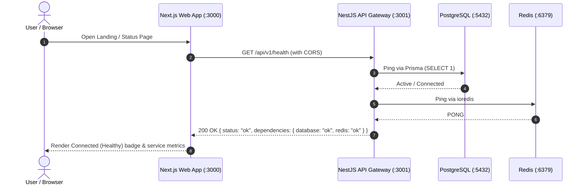
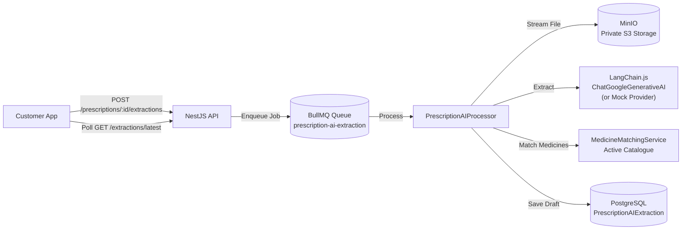

# System Architecture & Technical Design

This document details the architecture, design principles, and service topology for the Pharmacy Platform established in the system scaffolding.

---

## 1. Monorepo Organization

The project is structured as a **pnpm workspace** monorepo to isolate application domains while enabling seamless code sharing across the frontend and backend.

```text
pharmacy-platform/
│
├── apps/
│   ├── web/                     # Next.js 15 (App Router, React 19, Tailwind CSS)
│   └── api/                     # NestJS 11 (REST API, Swagger, Prisma, ioredis)
│
├── packages/
│   ├── shared-types/            # Contracts, DTO types, Health status models
│   ├── validation/              # Shared validation schemas & input helpers
│   └── config/                  # Shared TypeScript configuration base
│
├── infrastructure/
│   └── docker/
│       └── docker-compose.yml   # Multi-container infrastructure definition
│
├── docs/
│   └── architecture.md          # Architectural specification (this document)
│
├── .env.example                 # Environment configuration template
├── .gitignore                   # Multi-tier git exclusion rules
├── .npmrc                       # pnpm workspace behaviors
├── package.json                 # Monorepo root orchestration scripts
├── pnpm-workspace.yaml          # pnpm workspace definition and build allowances
└── README.md                    # Developer onboarding and operation guide
```

---

## 2. Frontend & Backend Separation

### Frontend (`apps/web`)

- **Framework**: Next.js 15 with React 19 and App Router.
- **Styling**: Tailwind CSS v4.
- **Isolation Principle**:
  - The frontend contains zero database access logic or direct secret access.
  - All communication is routed over HTTP to the backend REST API (`/api/v1/*`).
  - Route groups are pre-structured for future portal segmentation:
    - Customer Portal (prescription uploads, ordering)
    - Pharmacist Portal (schedule verification, approvals)
    - Admin Operations Portal (store inventory & compliance monitoring)

### Backend (`apps/api`)

- **Framework**: NestJS 11 with Express platform.
- **API Architecture**: REST API with global prefix `/api/v1`.
- **Documentation**: Swagger OpenAPI interactive docs accessible at `/api/docs`.
- **Validation**: Global `ValidationPipe` with payload whitelisting and automatic type transformation.
- **Exception Handling**: Global `AllExceptionsFilter` producing predictable, standardized error envelopes.
- **Database Access**: Encapsulated in `PrismaModule` and `PrismaService` extending `PrismaClient` with connection lifecycle management.

---

## 3. Communication Pattern



- **CORS Handling**: NestJS enables CORS specifically for the frontend origins (`http://localhost:3000`, `http://127.0.0.1:3000`) and supports credentials.
- **Health Verification**: `/api/v1/health` actively probes both PostgreSQL and Redis. If either service is down or unreachable, the endpoint responds with HTTP `503 Service Unavailable` with degraded statuses.

---

## 4. Infrastructure Services (Docker Compose)

All external dependencies run via Docker Compose in isolated containers with health checks, persistent volumes, and explicit port bindings:

| Service        | Container Name      | Image                    | Internal Port | Host Port                  | Purpose                                                                |
| :------------- | :------------------ | :----------------------- | :------------ | :------------------------- | :--------------------------------------------------------------------- |
| **PostgreSQL** | `pharmacy-postgres` | `postgres:16-alpine`     | 5432          | 5432                       | Primary relational database for transactions, catalogues, and users    |
| **Redis**      | `pharmacy-redis`    | `redis:7-alpine`         | 6379          | 6379                       | Fast caching, session states, and BullMQ background job queues         |
| **MinIO**      | `pharmacy-minio`    | `minio/minio:latest`     | 9000, 9001    | 9000 (API), 9001 (Console) | S3-compatible private object storage for prescription images and scans |
| **Mailpit**    | `pharmacy-mailpit`  | `axllent/mailpit:latest` | 1025, 8025    | 1025 (SMTP), 8025 (Web UI) | Local email capture and testing without external mail servers          |

### Persistent Named Volumes

- `pharmacy_postgres_data` -> preserves PostgreSQL data across container restarts.
- `pharmacy_redis_data` -> preserves AOF Redis data across container restarts.
- `pharmacy_minio_data` -> preserves stored prescription files across container restarts.

Stopping containers via `pnpm infra:down` safely shuts down containers without removing these volumes.

---

## 5. Shared Packages Strategy

The workspace packages are isolated from backend business logic and designed for contract sharing:

### `@pharmacy/shared-types` (`packages/shared-types`)

- Defines cross-boundary data shapes, API response contracts, and enums.
- Includes:
  - User and portal role definitions (`CUSTOMER`, `PHARMACIST`, `ADMIN`, `COMPLIANCE_ADMIN`).
  - Medicine schedule categories (`OTC`, `SCHEDULE_H`, `SCHEDULE_H1`, `SCHEDULE_X`, `NARCOTIC`).
  - Order status transitions and prescription draft representations.

### `@pharmacy/validation` (`packages/validation`)

- Hosts universal validation rules, regexes, and shared schemas.
- Houses validation constraints for prescription file sizes, phone formats, and order payload rules.

### `@pharmacy/config` (`packages/config`)

- Centralizes shared configuration such as base TypeScript compiler options (`tsconfig.base.json`), avoiding duplicated configs across projects.

> [!IMPORTANT]
> Regulatory decisions and compliance enforcement (e.g. Schedule H/X verification, dispatch blocking) remain strictly encapsulated in backend services. Shared packages never execute compliance decisions.

---

## 6. Security & Environment Variable Isolation

- All environment variables are centralized in `.env.example`.
- Frontend exposure is restricted strictly to variables prefixed with `NEXT_PUBLIC_` (`NEXT_PUBLIC_API_URL`).
- All database credentials, Redis passwords, MinIO root secrets, and backend port definitions remain completely hidden from the browser client.
- `.env` files are ignored by `.gitignore`.

---

## 7. AI-Assisted Prescription Reading Pipeline

This pipeline provides an asynchronous AI pipeline to extract medicine, strength, dosage instructions, and quantities from uploaded prescription documents and match them against the catalogue.



### Safety & Compliance Invariants

1. **Preliminary Draft Only:** AI extraction is explicitly not an approval.
2. **Immutable Orders:** AI extraction never changes Order status, OrderItems, CartItems, or payment states.
3. **No Independent Authorization:** AI output cannot authorize medicine dispatch or dispensing.
4. **Data Privacy:** Documents are read privately from MinIO by the backend worker; no public URLs are created. Extraction logs and audit events strictly scrub personal health information (PHI).
