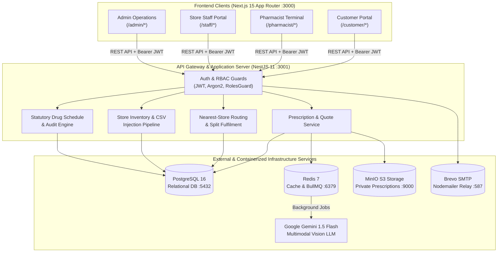
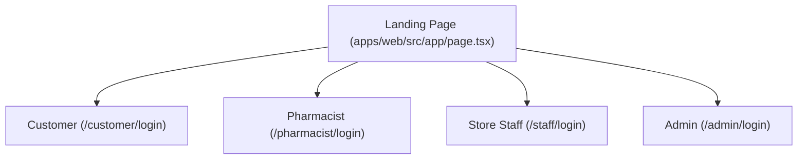
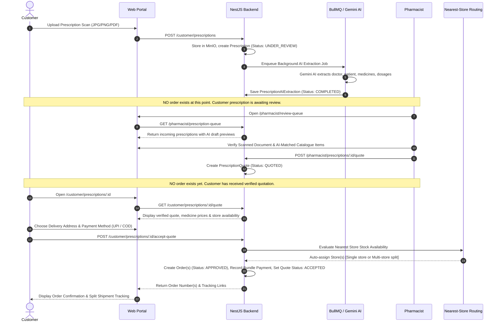
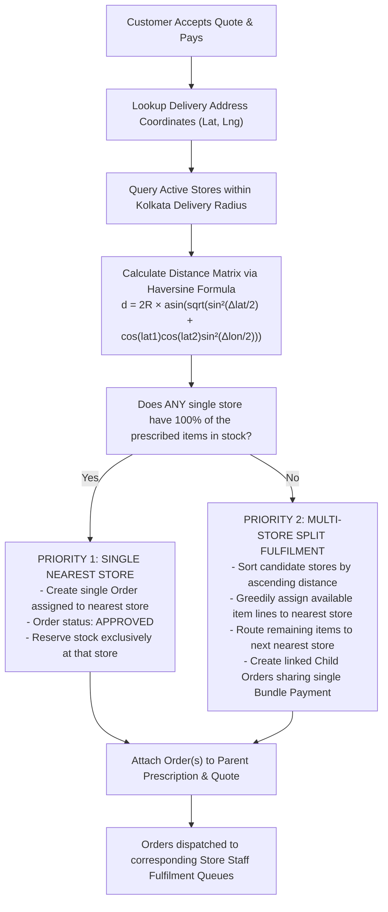

# System Architecture & Technical Design

This document provides a comprehensive technical specification of the Pharmacy Management Platform, covering system topology, external services, clinical lifecycle, multi-store inventory routing, schema validation, and unified interface design.

---

## 1. System Topology & Monorepo Organization

The application is structured as a **pnpm workspace monorepo**, maintaining strict separation between the Next.js frontend, NestJS backend, and shared domain packages.

```text
pharmacy-platform/
│
├── apps/
│   ├── web/                     # Next.js 15 (App Router, React 19, Tailwind CSS v4)
│   │   ├── src/app/             # 4 Portals: (/) Customer, Pharmacist, Store Staff, Admin
│   │   ├── src/components/      # Shared and portal-scoped UI components
│   │   └── src/lib/             # Auth context, API client, utilities
│   │
│   └── api/                     # NestJS 11 (REST API, Prisma ORM, BullMQ, Redis, MinIO)
│       ├── src/                 # Feature modules (prescriptions, orders, inventory, routing)
│       ├── prisma/              # Prisma schema, migrations, and realistic seed data
│       └── test/                # Unit, integration, and E2E test suites
│
├── packages/
│   ├── shared-types/            # Shared DTOs, API contracts, status enums, user roles
│   ├── validation/              # Input sanitization and universal validation schemas
│   └── config/                  # Shared base TypeScript configurations (tsconfig.base.json)
│
├── infrastructure/
│   └── docker/
│       └── docker-compose.yml   # Containerized services (PostgreSQL, Redis, MinIO)
│
└── docs/                        # Architectural documentation, demo guides, audit reports
```

### High-Level System Architecture



---

## 2. External Services & Infrastructure Topology

All stateful dependencies are provisioned via Docker Compose (`infrastructure/docker/docker-compose.yml`) with automated health checks, restart policies, and named persistent volumes.

| Service | Container Name | Image | Host Port | Internal Port | Protocol / Credentials | Architectural Purpose |
| :--- | :--- | :--- | :--- | :--- | :--- | :--- |
| **PostgreSQL** | `pharmacy-postgres` | `postgres:16-alpine` | `5432` | `5432` | `postgresql://` | Primary relational store for ACID transactions, catalogue, order states, store inventories, and immutable audit logs. |
| **Redis** | `pharmacy-redis` | `redis:7-alpine` | `6379` | `6379` | `redis://` | OTP delivery tokens and rate limits, refresh-token sessions (with native TTL-based expiry and revocation), and BullMQ task queues for asynchronous background processing. |
| **MinIO** | `pharmacy-minio` | `minio/minio:latest` | `9000`<br/>`9001` (UI) | `9000`<br/>`9001` | S3 API / HTTP | Private S3-compatible object storage for uploaded prescription images and documents with Server-Side Encryption at rest (SSE-S3 / SSE-KMS via `X-Amz-Server-Side-Encryption`). No public bucket access is permitted; signed short-lived URLs are generated on demand. |
| **Brevo** | *External Cloud* | N/A | `587` | `587` | SMTP (Nodemailer) | Transactional email delivery service for login OTP verification and welcome customer onboarding emails. |
| **Google Gemini AI** | *External Cloud* | `gemini-1.5-flash` | N/A | 443 (HTTPS) | Google AI SDK / LangChain | Multimodal vision model for optical character recognition (OCR), handwritten medicine identification, dosage parsing, and safety warning generation. Includes deterministic mock provider fallback. |

### Health Verification & Probes

The backend exposes `/api/v1/health` implementing active readiness and liveness checks:
- **PostgreSQL**: Actively probed using `SELECT 1` via `PrismaClient`.
- **Redis**: Actively probed using `PING -> PONG` via `ioredis`.
- If either service becomes degraded or disconnected, the health controller responds with HTTP `503 Service Unavailable`, preventing traffic routing to unhealthy instances.

---

## 3. Four-Portal Unified Architecture & Role-Based Access Control

The platform serves four distinct user cohorts from a single unified portal selection landing page (`/`):



### Role & Access Matrix

| Role | Allowed Portals | Primary Scope & Responsibilities | Boundary Guarantees |
| :--- | :--- | :--- | :--- |
| `CUSTOMER` | `/customer/*` | Upload prescriptions, view verified quotations, select payment & delivery address, track orders, refill reminders. | Strictly scoped to own profile and associated `FamilyMember` records. |
| `PHARMACIST` | `/pharmacist/*` | Platform-wide clinical verification of uploaded doctor prescriptions, AI candidate validation, stock availability assessment across all hubs, customer quotation generation. | **Decoupled from store bindings.** Acts as a central clinical reviewer with global inventory visibility. |
| `STORE_STAFF` | `/staff/*` | Physical retail store daily CSV stock injections, live store stock monitoring, pick/pack/invoicing and physical handover of store-assigned order packages. | **Strictly locked to assigned store** (`StaffProfile.storeId`). Any attempt to read or modify other store inventory is denied with `STORE_BOUNDARY_VIOLATION`. |
| `ADMIN` | `/admin/*` | Platform governance, catalogue medicine CRUD, multi-store stock oversight, statutory compliance rule set activation (Schedule H/H1/X policies), operations analytics. | Multi-store administrative access across all 46 Kolkata retail stores and central warehouses. |

---

## 4. Prescription-First Clinical Ordering Lifecycle

A core invariant of the platform is that **an unreviewed prescription cannot have an order attached to it**. Orders are created strictly after pharmacist verification and customer payment.



### Safety & Invariant Guarantees
1. **Zero Phantom Orders**: Uploading an unverified prescription never increments order volume or holds active stock reservations.
2. **Customer Price Consent**: Medicines and prices are explicitly presented via `PrescriptionQuote` before customer authorization.
3. **Statutory Schedule Checks**: Pharmacist verification strictly checks statutory categories (`SCHEDULE_H`, `SCHEDULE_H1`). Schedule X and Narcotics cannot be approved for retail home delivery.

---

## 5. Nearest-Store Dynamic Auto-Assignment & Multi-Store Split Fulfilment Engine

When the customer accepts a verified quotation and completes bundle payment, the backend executes the **Haversine Distance Routing Algorithm** against active retail hubs.



### Bundle Payment Architecture
- Regardless of whether an order is fulfilled from a single hub or split across 2+ stores, the customer pays **once** (`Bundle Payment`).
- The payment transaction covers the full subtotal and single delivery fee.
- Each store receives a distinct sub-order (`Order` record) containing only the items they hold in stock, complete with local packing slips and delivery handovers.

### Store Fulfilment Lifecycle & State Progression
In the Store Staff Portal (`/staff/fulfilment`), store staff members sequentially mark each operational stage for their allocated order:
1. **Pick** (`/staff/fulfilment/[orderId]/pick`): Staff checks physical pharmacy shelves, verifies item SKUs and quantities, and marks items picked (or flags exceptions if stock is damaged/missing). Order moves to `PICKING`.
2. **Pack** (`/staff/fulfilment/[orderId]/pack`): Staff verifies brand integrity, batch shelf-life (> 6 months), and Schedule H/H1 statutory compliance, then marks packing complete. Order moves to `PACKED` and generates a local store tax invoice (`INV-STORE-...`).
3. **Store** (`/staff/fulfilment/[orderId]/store`): Staff places the sealed package in the designated store holding shelf, staging bin, or cold-chain rack (e.g. `Shelf A-01`, `Cold Bin #2`). Order moves to `READY_FOR_HANDOVER`.
4. **Handover to Delivery** (`/staff/fulfilment/[orderId]/handover`): Staff hands over the staged package to courier partner riders (Shadowfax, Dunzo, etc.) or counter collection, recording rider identity and AWB/tracking numbers. Stock is atomically decremented, stock reservations marked `CONSUMED`, and status transitions to `HANDED_OVER`. For COD orders, exact payment collection is verified and recorded.

---

## 6. Store-Level Inventory Management & Daily CSV Injection Pipeline

Inventory balances are tracked strictly at the physical store level (`Store.id`). Each store's on-hand stock and active reservations operate independently.

```mermaid
sequenceDiagram
    autonumber
    actor Staff as Store Staff Member
    participant UI as Staff Portal (/staff/inventory/import)
    participant API as NestJS Backend
    participant DB as PostgreSQL Database

    Staff->>UI: Select Daily Store Stock CSV
    UI->>API: POST /inventory/imports/validate (file, storeId)
    API->>API: Step 1: Schema-First Validation Pipeline
    Note over API: 1. Verify exact 3 headers: sku,quantity,reorderLevel<br/>2. Verify exact 3 columns per row<br/>3. Verify non-negative integer quantities<br/>4. Detect duplicate SKUs in file<br/>5. Verify SKUs exist in active Catalogue<br/>6. Zero database mutations occur!

    alt CSV Schema Has Errors
        API-->>UI: 200 OK { valid: false, errors: [...rowNumber, sku, reason...] }
        UI-->>Staff: Display Error Banner & Row Error Details; Processing Blocked
    else CSV Schema Is Valid
        API-->>UI: 200 OK { valid: true, totalRows: N, previewRows: [...] }
        UI-->>Staff: Display Green Check Badge & Preview Table; Enable Processing Button
        Staff->>UI: Click "Process & Inject into Store"
        UI->>API: POST /inventory/imports (file, locationType='STORE', locationId=storeId)
        API->>API: Step 2: Store Boundary Guard Check (User storeId == locationId)
        API->>DB: Atomic Transaction: Update InventoryBalance & Insert InventoryMovement batches
        API-->>UI: 201 Created { appliedRows: N, locationName: "Salt Lake Store" }
        UI-->>Staff: Display Success Confirmation; Live stock updated immediately!
    end
```

### Standard 3-Column CSV Schema

```csv
sku,quantity,reorderLevel
MED-TEL-40-001,150,20
MED-MET-500-001,200,30
MED-LEV-50-001,80,15
MED-PAR-500-002,300,50
MED-AMX-500-001,90,15
MED-ALP-05-001,40,10
```

---

## 7. Unified Healthcare Design System

The platform adopts a unified, trusted healthcare design system across **all four portals**, eliminating mismatched accent schemes:

```text
┌────────────────────────────────────────────────────────────────────────┐
│  Primary Brand:     Deep Healthcare Teal   #0D5C5A  (Hover: #093e3d)   │
│  Accent Tints:      Teal Surface           #F0FDFA  (50-level tint)    │
│                     Avatar Chip            #CCFBF1  (100-level tint)   │
│                     Border Highlight       #99F6E4  (200-level tint)   │
│  Neutral Surfaces:  Card Canvas            #FFFFFF  (Pure White)       │
│                     Border Gray            #EBECEF  (Slate-200)        │
│                     Page Background        #F8F9FB  (Canvas Soft Tint) │
│  Typography:        Headings               #0F172A  (Slate-900 Bold)   │
│                     Body Copy              #475569  (Slate-600 Regular)│
└────────────────────────────────────────────────────────────────────────┘
```

- **Semantic Warnings**: Amber (`#D97706` / `amber-50`) is strictly reserved for actionable system warnings (e.g. `Low Stock Alert`, `Schedule H1 Restricted`).
- **Semantic Success**: Emerald (`#059669` / `emerald-50`) is reserved for verified prescriptions and successful stock injections.
- **Consistent Component Library**: Buttons (`Button`), alerts (`SemanticAlert`), badges (`StatusBadge`), and dropzones share identical micro-interactions across Customer, Pharmacist, Store Staff, and Admin portals.

---

## 8. Security & Statutory Compliance Standards

1. **Authentication & Token Isolation**: Argon2id password hashing, HTTP-only secure cookie handling, short-lived JWT access tokens with Redis-backed revocation.
2. **Prescription Confidentiality & Encryption at Rest**: Documents are encrypted at rest using Server-Side Encryption (SSE-S3 / SSE-KMS with AES-256) and stored privately in MinIO/S3. Presigned read URLs expire in 5 to 15 minutes and are issued only to authenticated users with valid ownership or clinical authorization.
3. **Statutory H1 Drug Register**: Dispensing any Schedule H1 medicine automatically creates an immutable, append-only `H1RegisterEntry` recording patient name, prescriber details, batch number, and verifying pharmacist registration number.
4. **Audit Trail**: Sensitive actions (inventory adjustments, prescription rejections, price modifications) write to `AuditLogEntry` with actor IP address and pre/post state snapshots.
