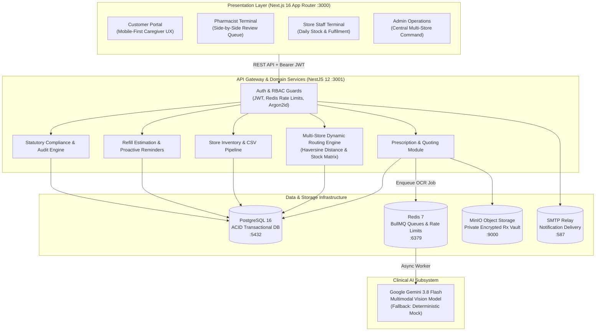
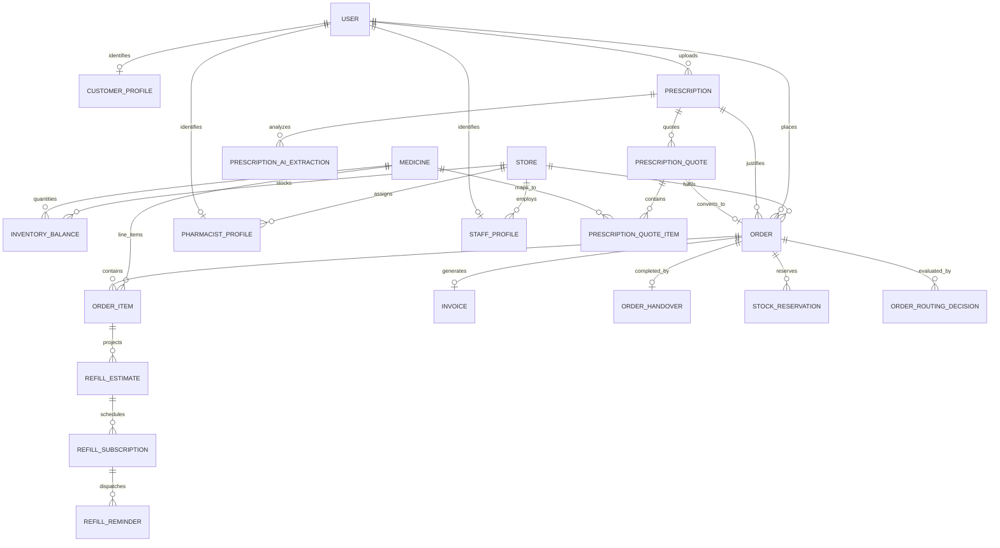
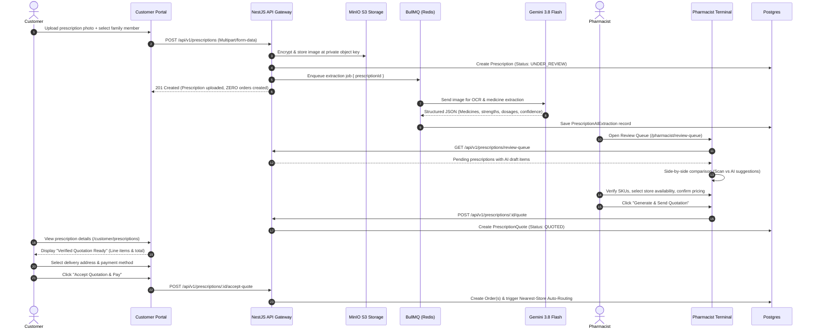
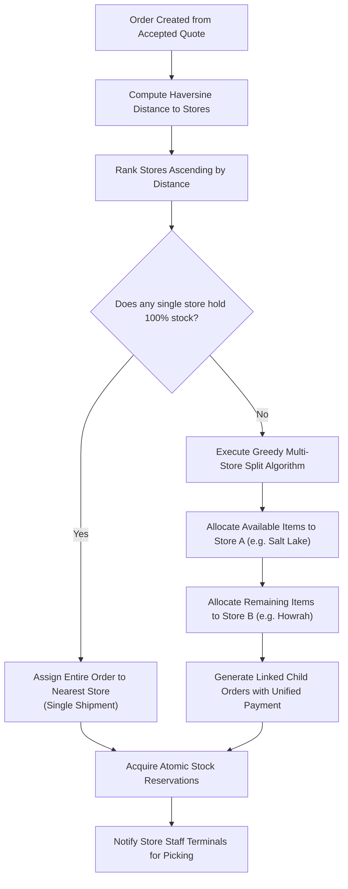
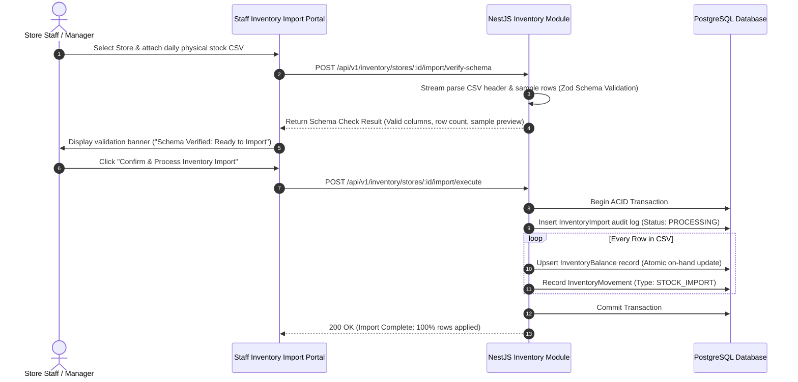
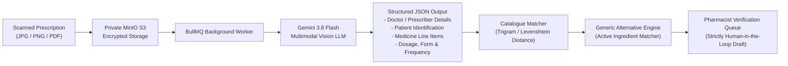

# Technical Design Document: Multi-Store Pharmacy Reordering & Clinical Verification Platform

**Repository**: [https://github.com/Anujanthwal-dotcom/assignment-isocode-labs](https://github.com/Anujanthwal-dotcom/assignment-isocode-labs)  
**System Baseline**: Next.js 16 (App Router), NestJS 12, PostgreSQL 16, Prisma ORM, Redis 7 / BullMQ, MinIO S3, Gemini 3.8 Flash  

---

## Table of Contents

1. [System Overview & Core Problem](#1-system-overview--core-problem)
2. [System Architecture & Technology Justification](#2-system-architecture--technology-justification)
3. [Data Model & Entity Specifications](#3-data-model--entity-specifications)
4. [Main Operational Flows](#4-main-operational-flows)
5. [AI Vision Pipeline & Clinical Safety Boundary](#5-ai-vision-pipeline--clinical-safety-boundary)
6. [UI & Design Decisions](#6-ui--design-decisions)
7. [Future Implementations & Scope Trade-Offs](#7-future-implementations--scope-trade-offs)

---

## 1. System Overview & Core Problem

### 1.1 Problem Statement

Regional pharmacy networks operating across dozens of retail stores (such as 46 physical retail hubs across Kolkata and Howrah) face major operational inefficiencies when managing recurring chronic maintenance therapies (diabetes, cardiovascular, hypertension, and thyroid treatments):

- **Fragmented WhatsApp / Phone Channels**: Customers submit photos of physical prescriptions through ad-hoc WhatsApp chats or phone calls to individual branch stores.
- **Isolated Inventory Silos**: Individual retail stores have zero visibility into sister store inventories. When a neighborhood store is out of stock of a particular medicine, the patient is turned away even if a branch 1.5 km away has adequate inventory.
- **Manual Verification & Compliance Risk**: Prescriptions stored on decentralized staff smartphones violate data privacy standards, and dispensing Schedule H/H1 medications without structured clinical review creates severe regulatory liabilities under the Drugs and Cosmetics Act.
- **Refill Drop-Off**: Chronic patients frequently miss refills due to lack of proactive dosage tracking and cumbersome reordering processes.

### 1.2 Core Architectural Principles

To address these challenges deterministically, the platform is engineered around four foundational principles:

1. **Email-Password Primary Authentication**:
   - Primary authentication across all portals is standard Email-Password.
   - Secured with Argon2id cryptographic password hashing, stateless JWT session tokens with HTTP-only cookies and bearer authorization, Redis-backed rate limiting, and automated SMTP password recovery.
2. **Multi-Store Split Order Fulfilment**:
   - If a single store cannot fulfill 100% of an approved prescription order, the routing engine dynamically splits the allocation into discrete child orders across the closest available branch stores.
3. **Consolidated Payment for Order Bundles**:
   - The customer authorizes payment once for the entire bundle of medicines. The system manages stock reservations, multi-store dispatch, and fulfillment tracking under a single parent transaction.
4. **Quad-Portal Persona Architecture**:
   - Four specialized interfaces with distinct role-based access control (RBAC):
     - **Customer Portal** (`/customer`): 1-minute chronic reordering, prescription uploads, family profile management, quotation approval, and bundle order tracking.
     - **Pharmacist Portal** (`/pharmacist`): Side-by-side zoomable prescription review, AI OCR draft verification, Schedule H/H1 compliance tagging, and quotation authoring.
     - **Store Staff Portal** (`/staff`): Daily stock CSV snapshot verification and ingestion, digital pick-and-pack checklists, and courier handover logging.
     - **Admin Portal** (`/admin`): Chain-wide multi-store inventory visibility, order throughput telemetry, stockout alerts, and statutory audit logging.

### 1.3 System Assumptions

The technical architecture and operational workflows are designed under the following foundational assumptions:

1. **Email-Password Primary Authentication**:
   - The Email-Password method is the primary way to log in across all four platform portals.
   - Secured using Argon2id password hashing, JWT session issuance with secure HTTP-only cookies / bearer authorization, Redis-backed rate limiting, and automated email password reset flows via Brevo SMTP relay.

2. **Split Order Creation for Multi-Store Fulfillment**:
   - If a single store cannot fulfill the order, multiple child orders are created for the fulfilment of it.
   - When no single retail branch holds 100% of the prescribed line items, the Haversine dynamic routing engine splits the verified quotation into discrete child orders across the nearest available branch stores (e.g., Store A fulfills in-stock cardiac medicines; Store B fulfills remaining endocrine medicines) to guarantee fulfillment and prevent drop-off.

3. **Consolidated Payment for Order Bundles**:
   - The user pays for the bundle of orders in a single consolidated transaction.
   - Customers do not face fragmented checkouts or multiple payments. The system aggregates all child fulfillment orders under a unified parent order bundle. The customer authorizes payment once (via UPI simulator, Net Banking, or single Cash on Delivery), and the backend ledger handles atomic stock reservations, fulfillment tracking, and store-level reconciliations transparently.

4. **Quad-Portal Role Architecture (4 Specialized Portals)**:
   - Four dedicated portals are created for customer, pharmacist, store staff, and admin personas:
     - **Customer Portal** (`/customer`): 1-minute chronic reordering, prescription uploads, family profile management, quotation approval, and unified bundle tracking.
     - **Pharmacist Portal** (`/pharmacist`): Side-by-side zoomable prescription review, AI OCR validation, Schedule H/H1 compliance tagging, and quotation authoring.
     - **Store Staff Portal** (`/staff`): Retail store terminal for daily stock CSV snapshot injection, digital pick-and-pack checklists, batch number recording, and delivery courier handover.
     - **Admin Portal** (`/admin`): Central management dashboard providing chain-wide operational visibility across all 46 stores, real-time revenue and margin telemetry, stockout alerts, and DPDP / Schedule H1 statutory compliance audits.

5. **Direct Cart Purchasing Restricted to OTC Medicines**:
   - Only Over-The-Counter (OTC) medicines and general wellness products can be sold directly through the digital cart and instant checkout feature.
   - All prescription pharmaceuticals (Schedule H, Schedule H1, Schedule X, and controlled substances) strictly require physical prescription upload, AI draft OCR extraction, and licensed pharmacist clinical verification with formal quotation authoring before any order creation or payment can take place.

6. **Store Staff Order Status & Fulfilment Progression**:
   - Retail branch store staff are responsible for updating and progressing the operational status of child fulfillment orders assigned to their store via the dedicated Store Staff Portal (`/staff/fulfilment`).
   - Order progression follows a strict 4-stage chain-of-custody workflow: digital shelf picking (`PICKING` / item confirmation & batch tracking), statutory Good Pharmacy Practice verification & invoice generation (`PACKED`), physical staging bin allocation (`READY_FOR_HANDOVER`), and courier handover recording (`HANDED_OVER_TO_DELIVERY` / dispatch), driving real-time order tracking telemetry for the customer.

---

## 2. System Architecture & Technology Justification

### 2.1 Monorepo Topology

The platform is structured as a **pnpm workspace monorepo** enforcing strict modularity between presentation layers, backend micro-modules, and shared domain contracts:

```text
pharmacy-platform/
├── apps/
│   ├── web/                     # Next.js 16 (App Router, React 19, Tailwind CSS v4)
│   │   ├── src/app/customer/    # Patient & Caregiver Portal
│   │   ├── src/app/pharmacist/  # Clinical Verification & Quoting Terminal
│   │   ├── src/app/staff/       # Retail Store Inventory & Fulfilment Hub
│   │   ├── src/app/admin/       # Multi-Store Management Dashboard
│   │   └── src/components/      # Shared atomic design system
│   │
│   └── api/                     # NestJS 12 (Modular REST API, TypeScript 5.9, Prisma ORM)
│       ├── src/prescriptions/   # S3 upload, Gemini multimodal OCR extraction, quotes
│       ├── src/order-routing/   # Haversine distance matrix, greedy multi-store router
│       ├── src/inventory/       # Store balance management, 2-step CSV import pipeline
│       ├── src/refills/         # Refill calculation engine, cron automation
│       ├── src/compliance/      # Statutory Schedule H/H1/X rules engine & audit logger
│       ├── src/fulfilment/      # Order lifecycle, picking checklist, invoices, handovers
│       └── prisma/              # PostgreSQL schema, migrations, seed data
│
├── packages/
│   ├── shared-types/            # Shared DTOs, API contracts, status enums, role definitions
│   ├── validation/              # Zod schemas, input sanitizers, formatters
│   └── config/                  # Shared TypeScript, ESLint, and Tailwind configurations
│
└── infrastructure/
    └── docker/
        └── docker-compose.yml   # Containerized PostgreSQL 16, Redis 7, MinIO S3
```

### 2.2 System Architecture Diagram



### 2.3 Technology Selection Rationale

| Layer / Component | Technology Selected | Alternatives Evaluated | Architectural Justification |
| :--- | :--- | :--- | :--- |
| **Backend Framework** | **NestJS 12 (Node.js)** | Express, FastAPI, Go Gin | Modular dependency injection enforces strict boundaries between clinical compliance, routing, and inventory modules. Built-in execution lifecycle interceptors, pipes, and guards guarantee deterministic RBAC enforcement across all endpoints. |
| **Frontend Framework** | **Next.js 16 (React 19)** | Single Page App (Vite + React) | Host all 4 specialized persona portals in a single cohesive codebase using route groups. Zero-bundle React Server Components, server actions for optimized data fetching, and unified Tailwind CSS design tokens. |
| **Primary Database** | **PostgreSQL 16** | MongoDB, MySQL | High-concurrency retail pharmacy operations require strict ACID transactions for multi-store stock reservations to prevent race conditions. Native support for structured JSONB fields enables flexible audit trails and AI extraction metadata. |
| **ORM & Migrations** | **Prisma ORM** | TypeORM, Drizzle, MikroORM | End-to-end type safety directly synchronizing database models with API contracts and frontend client types. Declarative relation tracking prevents orphaned medical records and invalid foreign keys. |
| **Queue & Cache** | **Redis 7 + BullMQ** | RabbitMQ, AWS SQS | Decouples compute-heavy AI vision processing and periodic refill reminder scans from user HTTP request cycles. Redis also provides microsecond rate-limiting for login authentication and session revocation. |
| **Object Storage** | **MinIO S3** | Local filesystem, MongoDB GridFS | S3 API-compatible private object storage. Guarantees zero public bucket access; document retrieval is locked behind time-expiring HMAC pre-signed URLs with cryptographic audit logging. |
| **AI Vision Engine** | **Gemini 3.8 Flash** | Tesseract OCR, AWS Textract | High accuracy in recognizing handwritten doctor prescriptions with multilingual clinical terminology (Bengali and English). Direct extraction into structured JSON schema matching our internal medicine catalogue. |

---

## 3. Data Model & Entity Specifications

The platform's data model comprises six interconnected domain clusters: Identity & Profiles, Physical Stores & Inventory, Prescriptions & AI Extractions, Orders & Fulfilment, Chronic Refills, and Compliance Auditing.

### 3.1 Entity-Relationship Diagram



### 3.2 Core Entity Specifications

#### 1. Identity & Profiles
- **`User`**: Base identity entity storing `email`, `passwordHash` (Argon2id), `role` (`CUSTOMER`, `PHARMACIST`, `STORE_STAFF`, `ADMIN`), and account status.
- **`CustomerProfile`**: Patient metadata including primary delivery address, phone, and linked `FamilyMember` records for caregiver prescription management.
- **`PharmacistProfile`**: Clinical verification credentials including Pharmacy Council registration number, state council identification, and active verification metrics.
- **`StaffProfile`**: Store operational staff assigned to a specific physical retail `Store`.

#### 2. Physical Stores & Inventory
- **`Store`**: Represents each retail branch with physical geocoordinates (`latitude`, `longitude`), operational status, contact information, and delivery radius limits.
- **`Medicine`**: Master pharmaceutical catalogue item specifying brand name, generic composition, dosage form (tablet, capsule, syrup, injection), strength, unit price, and drug schedule (`OTC`, `SCHEDULE_H`, `SCHEDULE_H1`, `SCHEDULE_X`).
- **`InventoryBalance`**: On-hand physical quantity per medicine per store (`quantity`, `reorderLevel`). Enforces a composite unique key `@@unique([medicineId, storeId])` ensuring atomic stock operations.
- **`InventoryMovement`**: Immutable audit log of every stock change (`STOCK_IMPORT`, `RESERVATION_HOLD`, `RESERVATION_RELEASE`, `DISPENSED`, `ADJUSTMENT`).

#### 3. Prescriptions & Clinical Quotes
- **`Prescription`**: Sensitive medical document uploaded by customer. Stores MinIO S3 `objectKey`, upload metadata, verification status (`UPLOADED`, `UNDER_REVIEW`, `APPROVED`, `REJECTED`, `REUPLOAD_REQUIRED`), and patient link (`familyMemberId`).
- **`PrescriptionAIExtraction`**: Immutable record of background multimodal AI OCR output. Stores candidate medicines, detected dosages, frequencies, confidence scores, and raw JSON payload.
- **`PrescriptionQuote`**: Pharmacist-authored commercial quotation generated *before* any order exists. Contains approved line items, substitution notes, price breakdown, and delivery fee.
- **`PrescriptionQuoteItem`**: Individual SKU mapped to catalogue `Medicine`, confirmed price, daily dosage, and availability status.

#### 4. Orders & Multi-Store Fulfilment
- **`Order`**: Order fulfillment entity generated only *after* customer quotation acceptance and payment. Tracks `orderNumber` (`ORD-YYYYMMDD-XXXX`), status (`PENDING_VERIFICATION`, `ROUTED`, `PICKING`, `PACKED`, `READY_FOR_HANDOVER`, `DISPATCHED`, `DELIVERED`), delivery address snapshot, and parent/child relationship for split orders.
- **`OrderItem`**: Frozen price snapshot (`unitPrice`, `quantity`, `lineTotal`) and individual item review status.
- **`StockReservation`**: Soft inventory lock (`ACTIVE`, `RELEASED`, `CONSUMED`) assigned to the routed store during packing with an automatic expiration TTL.
- **`OrderRoutingDecision`**: Immutable log of routing engine execution, including evaluated candidate stores, Haversine distances, and stock availability scores.

#### 5. Chronic Refill Automation
- **`RefillEstimate`**: Projected medicine exhaustion date computed from verified clinical dosage:
  $$\text{Supply Days} = \left\lfloor \frac{\text{Dispensed Quantity}}{\text{Units per Dose} \times \text{Doses per Day}} \right\rfloor$$
- **`RefillSubscription`**: Customer-managed recurring refill rule (`ACTIVE`, `PAUSED`, `CANCELLED`) with configured notification lead time (`reminderDaysBefore`, default 5 days).
- **`RefillReminder`**: Idempotent dispatch log tracking notifications sent across channels.

#### 6. Regulatory Compliance & Audit
- **`ComplianceRule`**: Mapped to statutory drug classifications (`OTC`, `SCHEDULE_H`, `SCHEDULE_H1`, `SCHEDULE_X`, `NARCOTIC`). Configures flags: `requiresPrescription`, `requiresPharmacistApproval`, `requiresH1Register`, and `hardBlocked`.
- **`H1RegisterEntry`**: Statutory Schedule H1 sales register mandated by the Drugs and Cosmetics Rules. Captures patient details, prescriber registration, drug batch number, quantity, dispensing pharmacist registration number, and timestamp.
- **`AuditLog`**: Tamper-evident record of all sensitive actions (document view, quotation generation, prescription approval, inventory overwrite) with actor ID, IP address, and timestamp.

---

## 4. Main Operational Flows

### 4.1 Flow A: Prescription-First Quotation & Ordering Lifecycle

In standard e-commerce platforms, an order is created immediately at cart checkout. In regulated retail pharmacy, creating an unverified order for Schedule H/H1 drugs is unlawful. The platform implements a **Prescription-First Quotation Workflow**:



**Key Architectural Invariant**: No phantom or pending orders exist in the database while a prescription is undergoing review. Customer orders are generated only after clinical verification is complete and the customer has authorized payment.

---

### 4.2 Flow B: Multi-Store Dynamic Routing & Split Fulfilment

When an order is authorized, the routing engine queries all active stores in the network to allocate inventory closest to the delivery destination.

#### Routing Algorithm:

1. **Geocoordinate Resolution**: Resolve delivery latitude and longitude $(lat_C, lon_C)$.
2. **Haversine Distance Matrix**: For each active store $S_i$ with coordinates $(lat_S, lon_S)$, compute great-circle distance $d(C, S_i)$:
   $$a = \sin^2\left(\frac{\Delta lat}{2}\right) + \cos(lat_C)\cos(lat_S)\sin^2\left(\frac{\Delta lon}{2}\right)$$
   $$d = 2R \cdot \text{atan2}\left(\sqrt{a}, \sqrt{1-a}\right) \quad (R = 6371 \text{ km})$$
3. **Sort Candidate Stores**: Rank stores ascending by distance: $[S_1, S_2, \dots, S_N]$.
4. **Single-Store Check (Priority 1)**: Iterate through candidate stores. If any single store $S_k$ has on-hand balance $\ge$ requested quantity for **100% of the line items**, allocate the entire order to $S_k$.
5. **Multi-Store Split Allocation (Priority 2)**: If no single store holds 100% stock, execute a greedy allocation:
   - Allocate available in-stock items to nearest store $S_1$ and create Child Order 1.
   - Allocate remaining items to next closest store $S_2$ and create Child Order 2.
   - Continue until all items are allocated or flagged for central warehouse fulfillment.
   - **Unified Payment Guarantee**: The customer pays once for the combined order bundle; child shipment orders are managed transparently by the backend.



---

### 4.3 Flow C: Automated Chronic Refill Forecasting & Proactive Reminders

To maintain continuous therapy adherence for chronic patients, the platform automates run-out calculations from dispensed clinical data:

1. **Run-Out Date Computation**:
   $$\text{Run-Out Date} = \text{Dispensed Timestamp} + \left\lfloor \frac{\text{Dispensed Quantity}}{\text{Daily Dosage Units}} \right\rfloor$$
2. **Reminder Trigger Date**:
   $$\text{Trigger Date} = \text{Run-Out Date} - \text{Reminder Lead Time (Default 5 Days)}$$
3. **Automated BullMQ Worker**: A scheduled daily worker queries active `RefillEstimate` records where `Trigger Date \le Current Date`.
4. **1-Tap Reorder Action**: The customer receives an alert containing a deep link that pre-populates their cart with the exact chronic maintenance SKU and verified dosage, allowing reorder completion in under 60 seconds.

---

### 4.4 Flow D: Daily CSV Inventory Injection Pipeline

Rather than relying on fragile real-time database links to legacy store POS machines, the platform implements a high-throughput, schema-validated daily CSV import pipeline:



---

### 4.5 Flow E: Store Fulfilment & Handover Lifecycle

Once routed, store staff execute fulfillment through a 4-stage digital workflow:

1. **Digital Picking Checklist** (`/staff/fulfilment/:id/pick`): Staff verify item name, strength, batch number, expiry date, and physical shelf location. Exceptions can be flagged with reasons (damaged stock, expired batch).
2. **Pre-Packing Verification** (`/staff/fulfilment/:id/pack`): Verification of cold-chain packaging (if required), prescription copy inclusion, and tamper-evident packaging seals.
3. **Staging & Bin Location** (`/staff/fulfilment/:id/store`): The packed order is moved to `READY_FOR_HANDOVER` and assigned to a specific holding shelf/bin.
4. **Courier Handover & H1 Logging** (`/staff/fulfilment/:id/handover`): Recording of delivery courier details, handover timestamp, and automated entry creation in the statutory Schedule H1 sales register.

---

## 5. AI Vision Pipeline & Clinical Safety Boundary

### 5.1 Architecture of the Prescription Reader

Handwritten medical prescriptions present significant challenges: cursive doctor handwriting, multilingual annotations (Bengali and English), and variable lighting conditions.



#### Extraction Schema:
The Gemini vision prompt enforces strict JSON output adhering to the domain DTO:
```json
{
  "doctor": {
    "name": "Dr. S. K. Mukherjee",
    "regNumber": "WBMC-48291",
    "clinic": "Kolkata Heart Clinic"
  },
  "patient": {
    "name": "Amitava Roy",
    "age": 58,
    "gender": "MALE"
  },
  "medicines": [
    {
      "detectedName": "Telma 40mg",
      "dosage": "1 tablet daily morning",
      "durationDays": 30,
      "confidence": 0.94
    }
  ]
}
```

### 5.2 Deterministic Clinical Safety Guardrails

> [!CAUTION]
> **Strict Clinical Guardrail**: The AI subsystem is explicitly prohibited from exercising autonomous clinical discretion. Under no circumstance does an AI extraction directly create an order, reserve stock, or dispense medication.

1. **Non-Binding AI Output**: AI extractions are treated purely as unverified drafts. They are rendered in the pharmacist's terminal as suggestions awaiting human review.
2. **Mandatory Licensed Pharmacist Review**: A registered pharmacist must inspect each line item, confirm or modify the SKU mapping against the active catalogue, verify dosages, and author the quotation.
3. **Unreadable Document Handling**: If an image is blurry or illegible (confidence score $< 0.60$ or flagged by the pharmacist), the system triggers a `REUPLOAD_REQUESTED` notice to the customer with specific photography guidelines.
4. **Generic Substitution Consent**: When an active-ingredient equivalent with a lower price is available, it is suggested to the pharmacist. If approved by the pharmacist, it is presented to the customer as an optional cost-saving switch requiring explicit customer consent before cart addition.
5. **Zero Autonomous Medical Advice**: The system never provides algorithmic diagnoses, drug-drug interaction warnings, or treatment guidance directly to consumers.

---

## 6. UI & Design Decisions

### 6.1 Healthcare UX Principles

The user interface follows healthcare-specific ergonomics designed for chronic patients, senior citizens, and busy retail staff:

- **Calm, Clinical Color Palette**: Primary deep clinical teal (`#0D5C5A`), soft mint tint surfaces (`#F0FDFA`), clean neutral borders (`#E2E8F0`), and high-contrast charcoal typography (`#0F172A`).
- **Senior & Caregiver Accessibility**: Large interactive touch targets (minimum 44px), WCAG AAA contrast ratios, clear typography (Inter font family), and complete absence of upsell popups, promotional banners, or dark patterns.
- **Trilingual Accessibility**: Frontend architecture supports **English**, **Bengali (বাংলা)**, and **Hindi (हिन्दी)** to serve the diverse demographic profile of Kolkata and Howrah.

### 6.2 Key Screen Analysis

| # | Portal / Screen | Target User | Layout & Interaction Decisions | Clinical & Operational Justification |
| :--- | :--- | :--- | :--- | :--- |
| **1** | **Customer Home & 1-Tap Reorder** (`/customer`) | Patient / Caregiver | Prominent 1-tap reorder card at the top displaying patient name, previous chronic medicines, and run-out countdown. | Enables elderly patients and adult caregivers to reorder recurring medicines in under 60 seconds without searching. |
| **2** | **Prescription Upload** (`/customer/prescriptions`) | Patient / Caregiver | Clean drag-and-drop zone, camera capture button, family profile selector dropdown, and privacy assurance badges. | Reduces friction in prescription submission; family profiles ensure clear separation between family members' therapies. |
| **3** | **Pharmacist Side-by-Side Review Queue** (`/pharmacist/review-queue`, `.../verify`) | Registered Pharmacist | Split-screen interface: left pane displays high-resolution zoomable scanned prescription; right pane displays AI draft medicines alongside live catalogue lookup. | Enables instantaneous visual cross-verification without switching tabs or losing clinical context; reduces verification time to under 5 minutes. |
| **4** | **Verified Quotation & Checkout** (`/customer/checkout`, `/customer/prescriptions`) | Patient / Caregiver | Itemized breakdown of pharmacist-approved medicines, unavailable item notices, delivery address selector, and payment toggles. | Establishes clinical trust; the customer knows exactly what was approved and the exact cost before committing payment. |
| **5** | **Store Fulfilment Terminal** (`/staff/fulfilment`, `.../pick`, `.../pack`, `.../store`, `.../handover`) | Retail Store Staff | 4-stage operational flow: digital picking checklist with per-item confirm & exception flagging, statutory pre-packing verification, holding shelf / bin staging (`READY_FOR_HANDOVER`), and courier delivery handover logger. | Eliminates picking errors; enforces physical verification before invoice generation, staging control, and physical delivery handover. |
| **6** | **Central Multi-Store Admin Overview** (`/admin`, `/admin/stores`) | Operations Head / Admin | Consolidated dashboard displaying chain-wide order volume across all stores, verification latency, and stockout alerts. | Provides central management with real-time operational visibility across the entire store network. |

---

## 7. Future Implementations & Scope Trade-Offs

### 7.1 Deliberate Engineering Boundaries (MVP Cuts)

To maintain focused execution and architectural stability, specific capabilities were deliberately scoped out of the initial build:

1. **Direct POS Database Synchronization**: Direct continuous integration with disparate legacy POS machines across 46 stores was cut to prevent store-level network dropouts from compromising central database integrity. Replaced with the schema-validated **Daily CSV Inventory Injection Pipeline**.
2. **Third-Party Road Traffic Matrix API**: Store routing uses the mathematical Haversine spherical distance formula rather than external paid traffic APIs (e.g., Google Distance Matrix), executing in sub-millisecond time without external network latency or cost.
3. **Doctor Teleconsultations**: Telemedicine features were scoped out to keep the platform focused strictly on prescription verification and chronic reordering without introducing clinical malpractice exposure.
4. **Diagnostic Lab Bookings**: Diagnostic test scheduling was excluded as it represents an entirely separate operational supply chain unrelated to retail pharmacy dispensing.
5. **Live Commercial Payment Gateway**: Implemented as a complete in-app payment simulator with full webhook and token interfaces, allowing live gateway drop-in via environment configuration.

### 7.2 Phase 2 & Future Roadmap

1. **Enterprise WhatsApp & SMS Gateway Integration**: Connect enterprise DLT-approved SMS and WhatsApp Business API gateways (Gupshup / Twilio) to deliver proactive refill reminders directly to customers' chat applications.
2. **Store Delivery Fleet Mobile Application**: Dedicated Progressive Web App (PWA) for store delivery drivers featuring route sequencing, GPS breadcrumbs, and digital customer OTP / signature capture upon delivery.
3. **Predictive Inter-Store Stock Rebalancing**: Algorithmic demand forecasting that analyzes 30-day chronic refill cycles across geographic zones to recommend automated inter-store stock transfers from the central warehouse before local stockouts occur.
4. **State Pharmacy Council Registry Integration**: Direct API integration with the West Bengal State Pharmacy Council to validate pharmacist registration numbers and renewal statuses in real time.
5. **Customer Barcode / QR Pill Bottle Scanner**: Mobile camera feature allowing patients to scan existing medicine strips or QR codes on prescription labels to instantly initiate a reorder.
