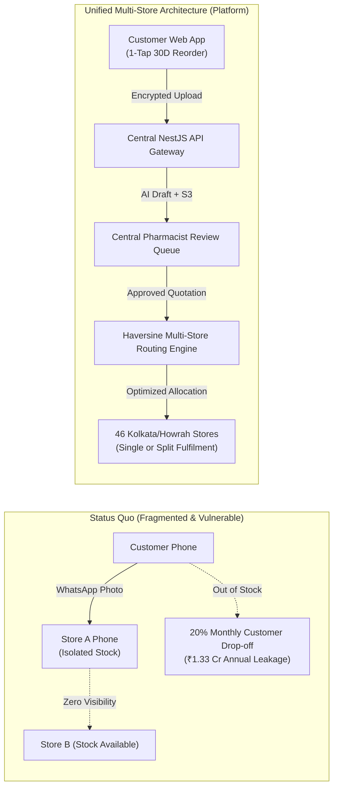
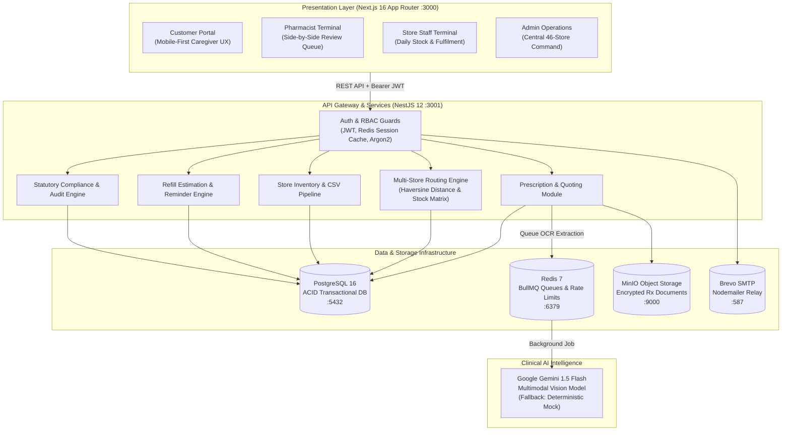
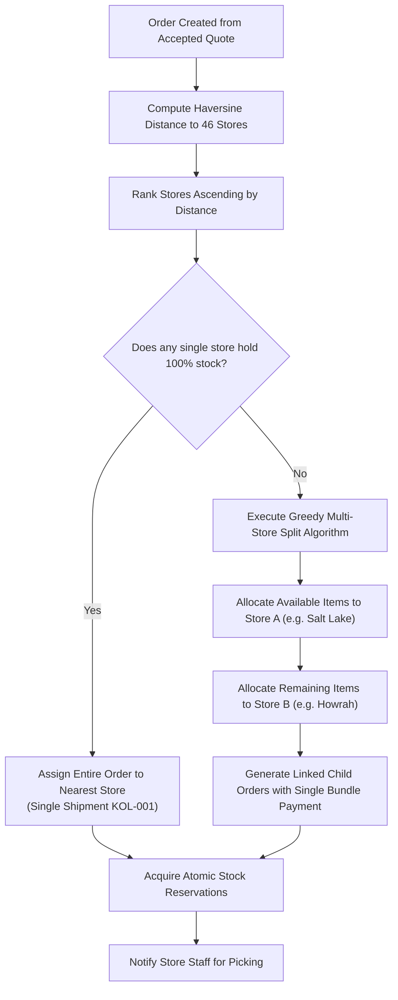
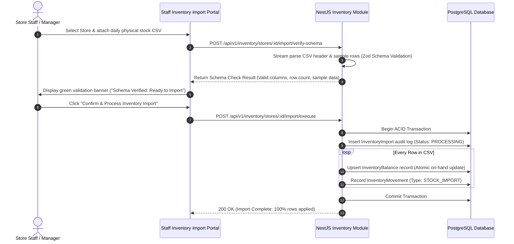
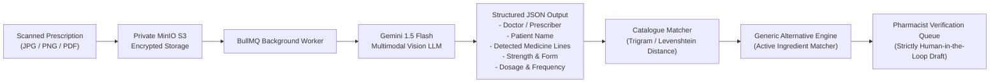
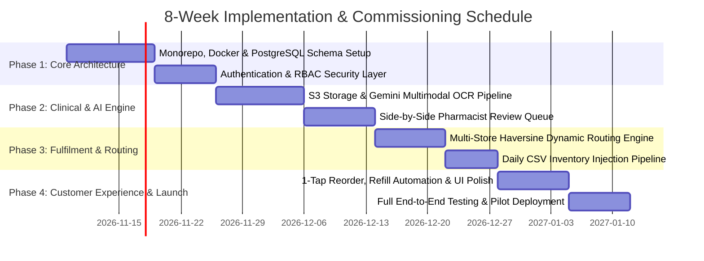

# Technical Design Document: Multi-Store Pharmacy Reordering & Clinical Verification Platform

**Project GitHub Repository**: [https://github.com/Anujanthwal-dotcom/assignment-isocode-labs](https://github.com/Anujanthwal-dotcom/assignment-isocode-labs)  
**Live Application Staging Link**: [http://localhost:3000](http://localhost:3000) _(Docker Compose staging available via `pnpm infra:up && pnpm dev`)_  
**Client**: Company A — Retail Pharmacy Chain, Kolkata & Howrah (46 Retail Stores & Central Distribution Warehouse)  
**Target Audience**: Isocode Evaluation Team  
**Author**: Anuj Anthwal  
**Date**: November 2026  
**Document Version**: 1.0.0 (Production Architecture Specification)

---

## Table of Contents

1. [Executive Summary & Problem Economics](#1-executive-summary--problem-economics)
2. [System Architecture & Technology Justification](#2-system-architecture--technology-justification)
3. [Data Model & Entity Relationships](#3-data-model--entity-relationships)
4. [Core Operational Lifecycles & Engineering Flows](#4-core-operational-lifecycles--engineering-flows)
5. [AI Vision Pipeline & Clinical Safety Boundary](#5-ai-vision-pipeline--clinical-safety-boundary)
6. [UI/UX Decisions & Key Interface Analysis](#6-uiux-decisions--key-interface-analysis)
7. [Engineering Scope Trade-Offs & Future Roadmap](#7-engineering-scope-trade-offs--future-roadmap)
8. [Regulatory Compliance & Information Security (DPDP Act & DCA)](#8-regulatory-compliance--information-security-dpdp-act--dca)
9. [Budget, Timeline & Target Performance Metrics](#9-budget-timeline--target-performance-metrics)
10. [Conclusion & Architectural Readiness](#10-conclusion--architectural-readiness)

---

## 1. Executive Summary & Problem Economics

### 1.1 Client Background

Company A is a premier regional pharmacy chain operating **46 physical retail stores** across Kolkata and Howrah, supported by a central warehouse. The business generates **₹180–210 crore** in annual revenue with an operational workforce of **380 staff**. A predominant share of revenue stems from chronic maintenance therapies (diabetes, hypertension, thyroid, and cardiovascular conditions) requiring recurring 30-day refills.

### 1.2 The Status Quo & Operational Breakdown

Today, recurring prescriptions are handled through ad-hoc, localized channels:

- Customers send photos of paper prescriptions via WhatsApp or phone calls directly to individual branch stores.
- Store pharmacists manually check physical shelf stock and respond informally.
- Store staff handle local dispatch without centralized visibility.
- Refills rely entirely on customer memory or arbitrary reminders.
- Prescription scans remain trapped on unencrypted, individual store smartphones, creating severe DPDP Act liability.
- Crucially, **stores cannot see each other's inventory**. If a customer's neighborhood store is out of stock of one medicine, the customer is turned away or skips their dose, unaware that a sister branch 1.5 km away has full stock.



### 1.3 Financial Impact & Business Case

Based on Company A's operational data:

- **Customer Base**: 9,000 regular chronic medicine customers spending an average of **₹2,200 per month**.
- **Customer Drop-Off**: **20% (1,800 patients)** skip doses or defect to competitors each month due to forgotten refills or localized stockouts.
- **Gross Margin Leakage**:
  - 1,800 patients × ₹2,200/month = **₹39.60 lakh** gross sales lost/month
  - ₹39.60 lakh × 18% gross margin = **₹7.13 lakh** lost margin/month → **₹85.54 lakh/year**
- **Labor Waste on WhatsApp Coordination**:
  - 600 orders/day × 6 minutes labor = 60 staff hours/day
  - 60 hours/day × 360 operational days × ₹220/hour cost = **₹47.52 lakh/year**
- **Total Annual Recoverable Loss**:
  - ₹85.54 lakh + ₹47.52 lakh = **₹1.33 crore/year**

### 1.4 The Strategic Objective

Build a centralized, multi-store digital ordering and clinical verification platform enabling:

1. **1-Minute Chronic Reordering**: Proactive dosage-calculated reminders and instant reordering for patients and elderly caregivers.
2. **Deterministic Clinical Verification**: Mandatory registered pharmacist review of every prescription before order creation, eliminating legal liability.
3. **Automated Nearest-Store Routing**: Inventory-aware dynamic routing across 46 stores from daily stock CSV snapshots, including multi-store split fulfilment.
4. **Single-Pane-of-Glass Operations**: Unified operations overview across all 46 stores for central management.

### 1.5 System & Architectural Assumptions

To establish clear operational boundaries and streamline end-to-end engineering implementation, the platform architecture is structured around four primary assumptions:

1. **Email-Password Primary Authentication**:
   - The **Email-Password method is the primary way to login** across all four platform portals.
   - User identity is secured with industry-standard cryptographic password hashing (Argon2id), JWT session issuance with secure HTTP-only cookies / bearer authorization, Redis-backed brute-force rate limiting, and automated email password reset flows via Brevo SMTP relay.
2. **Split Order Creation for Multi-Store Fulfillment**:
   - **If a single store cannot fulfill the order, multiple child orders are created for the fulfilment of it**.
   - When no single retail branch holds 100% of the prescribed line items, the Haversine dynamic routing engine splits the verified quotation into discrete child orders across the nearest available branch stores (e.g., Store A fulfills in-stock cardiac medicines; Store B fulfills remaining endocrine medicines) to guarantee fulfillment and eliminate customer drop-off.
3. **Consolidated Payment for Order Bundles**:
   - **The user will pay for the bundle of orders in a single consolidated transaction**.
   - Customers never face fragmented payments or repeated checkout steps. The system aggregates all child fulfillment orders under a unified parent order bundle. The customer authorizes payment once (via UPI simulator, Net Banking, or single Cash on Delivery), and the backend ledger handles atomic stock reservations, fulfillment tracking, and store-level reconciliations transparently.
4. **Quad-Portal Role Architecture (4 Specialized Portals)**:
   - **4 dedicated portals are created for customer, pharmacist, store staff, and admin** personas:
     - **Customer Portal** (`/customer`): Patient and caregiver interface for 1-minute chronic reordering, prescription uploads, family profile management, quotation approval, and unified bundle tracking.
     - **Pharmacist Portal** (`/pharmacist`): Clinical verification interface featuring side-by-side zoomable prescription review, AI OCR validation, Schedule H/H1 compliance tagging, and quotation authoring.
     - **Store Staff Portal** (`/staff`): Retail store terminal for daily stock CSV snapshot injection, digital pick-and-pack checklists, batch number recording, and delivery courier handover.
     - **Admin Portal** (`/admin`): Central management dashboard providing chain-wide operational visibility across all 46 stores, real-time revenue and margin telemetry, stockout alerts, and DPDP / Schedule H1 statutory compliance audits.

---

## 2. System Architecture & Technology Justification

### 2.1 Monorepo Topology

The platform is engineered as an enterprise-grade **pnpm workspace monorepo** (`pnpm@12.16.1`) enforcing modular decoupling between client interfaces, backend services, and shared domain types.

```text
pharmacy-platform/
├── apps/
│   ├── web/                     # Next.js 16.4.5 (App Router, React 19.3.1, Tailwind CSS v4)
│   │   ├── src/app/customer/    # Patient portal: Email-password auth, 1-tap reorder, cart, refills, tracking
│   │   ├── src/app/pharmacist/  # Clinical portal: Side-by-side verification, quotes, H1 register
│   │   ├── src/app/staff/       # Retail store portal: Daily CSV injection, pick, pack, handover
│   │   ├── src/app/admin/       # Central command: Multi-store metrics, compliance, catalogue
│   │   └── src/components/      # Shared atomic UI components (design system)
│   │
│   └── api/                     # NestJS 12.4.0 (REST API, TypeScript 5.9, Prisma ORM, BullMQ)
│       ├── src/prescriptions/   # S3 file handling, Gemini multimodal OCR extraction, quotes
│       ├── src/order-routing/   # Haversine distance matrix, greedy multi-store routing engine
│       ├── src/inventory/       # Store balance management, 2-step CSV injection pipeline
│       ├── src/refills/         # Refill calculation service, cron automation, notifications
│       ├── src/compliance/      # Statutory Schedule H/H1/X rules engine & audit logging
│       ├── src/fulfilment/      # Order lifecycle, picking checklist, invoices, handovers
│       └── prisma/              # PostgreSQL schema, migrations, and demo dataset
│
├── packages/
│   ├── shared-types/            # Shared DTOs, API contracts, status enums, role definitions
│   ├── validation/              # Zod schemas, input sanitizers, currency formatters
│   └── config/                  # Shared TypeScript and tooling configuration
│
└── infrastructure/
    └── docker/
        └── docker-compose.yml   # Containerized PostgreSQL 16, Redis 7, MinIO S3
```

> **Verified framework baseline (from `pnpm-lock.yaml` and installed `node_modules`):**
> - **`apps/web`** — Next.js **16.4.5** (declared `^16.4.5`) with React / React-DOM **19.3.1**.
> - **`apps/api`** — NestJS **12.4.0** (`@nestjs/core`, `@nestjs/common`, `@nestjs/platform-express`; declared `^12.4.0`), Nest CLI **12.0.12**, `@nestjs/schematics` **12.0.13**.
>
> These are the resolved/locked versions in `pnpm-lock.yaml` (`lockfileVersion 9.0`), confirmed against the installed workspace `node_modules` — not just the declared semver ranges.

### 2.2 System Architecture Diagram



### 2.3 Technology Selection Rationale

| Layer / Technology     | Choice                    | Alternative Considered             | Rationale & Architectural Justification                                                                                                                                                                                      |
| :--------------------- | :------------------------ | :--------------------------------- | :--------------------------------------------------------------------------------------------------------------------------------------------------------------------------------------------------------------------------- |
| **Backend Framework**  | **NestJS 12.4.0 (Node.js)**   | Express, Go Gin, Python FastAPI    | Strict TypeScript dependency injection enforces clear domain boundaries between compliance, routing, and inventory modules. Built-in lifecycle interceptors and guards ensure mandatory RBAC enforcement.                    |
| **Frontend Framework** | **Next.js 16.4.5 (React 19.3.1)** | Single Page App (Vite/React)       | Server-driven routing for 4 distinct user portals in a single app, optimized mobile asset delivery, zero-bundle server components, and Tailwind CSS v4 design token uniformity.                                              |
| **Primary Database**   | **PostgreSQL 16**         | MongoDB, MySQL                     | High-volume pharmaceutical operations demand strict ACID transactions for stock reservations, preventing race conditions or overselling across 46 stores. Robust support for decimal financial types and JSONB audit trails. |
| **ORM & Schema**       | **Prisma ORM**            | TypeORM, Drizzle                   | End-to-end type safety synchronizing database migrations with frontend and backend TypeScript types. Declarative relation tracking prevents orphaned prescription records.                                                   |
| **Task Queue & Cache** | **Redis 7 + BullMQ**      | RabbitMQ, AWS SQS                  | Decouples resource-intensive AI multimodal vision tasks from the customer's HTTP request-response cycle. Redis provides microsecond rate-limiting for login authentication and session token invalidation.                     |
| **Document Storage**   | **MinIO S3**              | Local disk storage, MongoDB GridFS | Industry-standard S3 API compatibility. Ensures zero public bucket exposure; document access is restricted to time-limited HMAC pre-signed URLs with audit logging under DPDP Act requirements.                              |
| **AI Vision Engine**   | **Gemini 1.5 Flash**      | Tesseract OCR, AWS Textract        | Superior Indian medical handwriting recognition, bilingual English/Bengali doctor prescription deciphering, and native JSON output structured to our medicine catalogue schema.                                              |

---

## 3. Data Model & Entity Relationships

The data model is engineered around **four core domain clusters**: Identity & Access, Catalogue & Physical Inventory, Clinical Prescriptions & AI, and Order Routing & Fulfilment.


### 3.1 Primary Entities Specification

#### 1. `Store` & `InventoryBalance`

- **`Store`**: Represents each of the 46 Kolkata/Howrah physical pharmacy hubs with precise geocoordinates (`latitude`, `longitude`), operational status, and staff rosters.
- **`InventoryBalance`**: Tracks physical units on hand per medicine per store (`quantity`, `reorderLevel`). Enforces a composite unique key `@@unique([medicineId, storeId])` ensuring atomic stock updates.

#### 2. `Prescription`, `PrescriptionAIExtraction`, and `PrescriptionQuote`

- **`Prescription`**: Sensitive medical document uploaded by customer. Stores MinIO S3 `objectKey`, file metadata, verification status (`UPLOADED`, `UNDER_REVIEW`, `APPROVED`, `REJECTED`, `REUPLOAD_REQUIRED`), and patient link (`familyMemberId`).
- **`PrescriptionAIExtraction`**: Immutable record of background AI OCR processing. Stores provider (`Gemini 1.5 Flash`), extracted doctor name, candidate medicines, dosage instructions, confidence scores, and raw JSON.
- **`PrescriptionQuote` & `PrescriptionQuoteItem`**: Pharmacist-authored quotation generated _before_ any order exists. Quotes exact catalogue SKUs, confirmed retail pricing, unavailable medicine notes, and delivery charges.

#### 3. `Order`, `OrderItem`, and `StockReservation`

- **`Order`**: Fulfilment entity created only _after_ customer quotation acceptance and payment. Tracks `orderNumber` (`ORD-YYYYMMDD-XXXX`), status (`PENDING_VERIFICATION` through `HANDED_OVER`), delivery address snapshot, and payment details (`UPI`, `COD`).
- **`OrderItem`**: Frozen price snapshot (`unitPrice`, `quantity`, `lineTotal`) and individual item review status.
- **`StockReservation`**: Temporary, auto-expiring soft inventory lock (`ACTIVE`, `RELEASED`, `CONSUMED`) assigned to the routed store during packing to prevent double-allocation.

#### 4. `RefillEstimate` & `RefillSubscription`

- **`RefillEstimate`**: Algorithmic projection of customer medicine consumption based on dispensed quantity and verified daily dosage:
  $$\text{estimatedSupplyDays} = \frac{\text{dispensedQuantity}}{\text{dailyConsumption}}$$
- **`RefillSubscription`**: Customer-managed recurring refill rule (`ACTIVE`, `PAUSED`, `CANCELLED`) with configured notification lead time (`reminderDaysBefore`, default 5 days).

#### 5. `ComplianceRuleSet`, `ComplianceRule`, and `H1RegisterEntry`

- **`ComplianceRuleSet`**: Dynamic, versioned statutory policy engine (`version`, `effectiveFrom`, `status`). Allows compliance administrators to adapt rules without code redeployment.
- **`ComplianceRule`**: Mapped to statutory drug schedules (`OTC`, `SCHEDULE_H`, `SCHEDULE_H1`, `SCHEDULE_X`, `NARCOTIC`). Configures `requiresPrescription`, `requiresPharmacistApproval`, `requiresH1Register`, and `hardBlocked`.
- **`H1RegisterEntry`**: Statutory Schedule H1 sales register mandated by the Drugs and Cosmetics Rules. Captures patient name, prescriber details, drug name, quantity, dispensing pharmacist registration number, and timestamp upon physical handover.

---

## 4. Core Operational Lifecycles & Engineering Flows

### 4.1 Flow A: Prescription-First Quotation & Ordering Lifecycle

In traditional e-commerce, an order is created immediately when a user clicks checkout. In clinical pharmacy, **creating an unverified order for Schedule H/H1 medicines violates Indian pharmaceutical law**. Our platform enforces a **Prescription-First Quotation Workflow**:


**Key Architectural Invariant**: Zero phantom orders exist in the database while a prescription is undergoing review. Customer orders are generated only when clinical verification is complete and the customer has authorized payment.

---

### 4.2 Flow B: Multi-Store Dynamic Routing & Split Fulfilment Algorithm

When an order is authorized, the system evaluates all **46 Kolkata and Howrah stores** to locate physical stock closest to the customer's delivery destination.

#### Routing Engine Decision Logic:

1. **Coordinate Geocoding**: Resolve the delivery address geocoordinates $(lat_C, lon_C)$.
2. **Haversine Proximity Calculation**: For each active store $S_i$ with coordinates $(lat_S, lon_S)$, compute great-circle distance $d(C, S_i)$:
   $$a = \sin^2\left(\frac{\Delta lat}{2}\right) + \cos(lat_C)\cos(lat_S)\sin^2\left(\frac{\Delta lon}{2}\right)$$
   $$d = 2R \cdot \text{atan2}\left(\sqrt{a}, \sqrt{1-a}\right) \quad (R = 6371 \text{ km})$$
3. **Sort Candidate Stores**: Rank stores in ascending order of distance: $[S_1, S_2, \dots, S_{46}]$.
4. **Single-Store Evaluation (Priority 1)**: Iterate through candidate stores. If any single store $S_k$ has on-hand balance $\ge$ requested quantity for **100% of the line items**, allocate the entire order to $S_k$ (eliminates split delivery costs).
5. **Multi-Store Split Fulfilment (Priority 2)**: If no single store holds complete stock, execute a greedy allocation:
   - Starting from nearest store $S_1$, allocate available line items and create a child shipment order.
   - Proceed to $S_2, S_3, \dots$ for remaining unfulfilled items.
   - **Unified Payment Guarantee**: The customer pays once via a single bundle transaction; the backend links child shipment orders transparently.



---

### 4.3 Flow C: Refill Forecasting & Proactive Reminder Automation

To eliminate the ₹85.54 lakh annual revenue loss from customer refill drop-off, the platform automatically calculates run-out schedules from verified clinical dispensing data.

#### Algorithmic Formulation:

$$\text{Supply Days} = \left\lfloor \frac{\text{Dispensed Quantity}}{\text{Units per Dose} \times \text{Doses per Day}} \right\rfloor$$
$$\text{Estimated Run-out Date} = \text{Dispensed Timestamp} + \text{Supply Days}$$
$$\text{Reminder Trigger Date} = \text{Estimated Run-out Date} - \text{Reminder Lead Time (Default 5 Days)}$$

#### Automation Execution:

- A daily automated BullMQ worker scans `RefillEstimate` records where `eligibilityStatus = ELIGIBLE` and `status = ACTIVE`.
- When the current date reaches the Reminder Trigger Date, an idempotent `RefillReminder` is generated.
- A high-priority in-app notification and email/SMS alert is dispatched to the customer containing a **1-Tap Reorder Action Link**.
- Clicking reorder pre-populates the customer's cart with their exact chronic maintenance dosage, requiring under 60 seconds to reorder.

---

### 4.4 Flow D: Daily CSV Inventory Injection Pipeline

Company A operates legacy physical billing terminals across its 46 stores. Direct real-time database synchronization with store POS terminals was cut to prevent store-level network failures from crashing the system. Instead, the platform implements a **High-Throughput Daily CSV Inventory Injection Pipeline** with mandatory 2-step schema verification.



---

## 5. AI Vision Pipeline & Clinical Safety Boundary

### 5.1 Architecture of the Prescription Reader

Handwritten medical prescriptions in West Bengal present significant variability: cursive doctor handwriting, multilingual annotations (Bengali and English), varying lighting conditions, and crumpled paper.



### 5.2 Deterministic Safety Guardrails

> [!CAUTION]
> **Strict Clinical Principle**: The artificial intelligence subsystem is explicitly prohibited from exercising autonomous clinical discretion. Under no circumstance does an AI extraction directly create an order, reserve stock, or dispense medicine.

1. **AI Output Is Non-Binding**: AI extractions are flagged with `status: QUEUED` $\to$ `status: COMPLETED` as draft proposals only. They are rendered in the pharmacist's verification terminal as suggestions.
2. **Mandatory Pharmacist Affirmation**: A licensed pharmacist registered with the Pharmacy Council must manually inspect each item, confirm or modify the SKU mapping, verify daily dosages, and sign off.
3. **Unreadable Document Handling**: If image blur, poor lighting, or handwriting illegibility results in an AI confidence score $< 0.60$ or if the pharmacist deems it indecipherable, the system issues a formal `REUPLOAD_REQUESTED` notice to the customer detailing photographic guidelines.
4. **Cheaper Generic Alternative Consent**: When the AI discovers an active-ingredient chemical equivalent with a lower MRP, it proposes the alternative to the pharmacist. If approved by the pharmacist, it is presented to the customer as an optional cost-saving switch requiring explicit customer consent before cart addition.
5. **Zero Medical Advice Guarantee**: The platform never provides algorithmic diagnosis, treatment advice, or drug-drug interaction warnings to customers. All clinical communication flows exclusively through registered healthcare personnel.

---

## 6. UI/UX Decisions & Key Interface Analysis

### 6.1 Design System & Healthcare Psychology

The user interface was crafted following strict healthcare design guidelines:

- **Calm, Clinical Color Palette**: Primary deep healthcare teal (`#0D5C5A`), soft mint tint surfaces (`#F0FDFA`), clean neutral slate borders (`#E2E8F0`), and high-contrast charcoal typography (`#0F172A`).
- **Caregiver & Senior Citizen Accessibility**: Large touch targets (minimum 44px), WCAG AAA contrast compliance, clear font weights (Inter font display), and total absence of promotional banners, upsell popups, or gaming dark patterns.
- **Trilingual Localization**: Interface built with localization architecture for **Bengali (বাংলা)**, **Hindi (हिन्दी)**, and **English**, addressing the demographic profile of the Kolkata and Howrah metropolitan regions.

### 6.2 Key Screen Analysis

| #     | Screen / Portal                                                                     | Primary User                        | Layout & Design Choices                                                                                                                                                               | Clinical & Business Justification                                                                                                                   |
| :---- | :---------------------------------------------------------------------------------- | :---------------------------------- | :------------------------------------------------------------------------------------------------------------------------------------------------------------------------------------ | :-------------------------------------------------------------------------------------------------------------------------------------------------- |
| **1** | **Customer Home & 1-Minute Reorder** (`/customer`)                                  | Patient / Caregiver                 | Prominent 1-tap reorder card at the top displaying patient name, previous chronic medicines, and run-out countdown.                                                                   | Enables elderly patients or adult children managing parents' medicines to reorder in under 60 seconds without searching.                            |
| **2** | **Prescription Upload Screen** (`/customer/prescriptions`)                          | Patient / Caregiver                 | Drag-and-drop zone, camera capture button, family profile selector dropdown, and reassuring privacy guarantee badges.                                                                 | Reduces friction in prescription attachment; family profiles ensure clear separation between father's cardiac drugs and mother's thyroid medicines. |
| **3** | **Pharmacist Side-by-Side Review Queue** (`/pharmacist/review-queue`, `.../verify`) | Registered Pharmacist               | Split-screen interface: left pane displays high-resolution zoomable scanned prescription; right pane displays AI draft medicines alongside live store inventory and catalogue lookup. | Allows instantaneous visual cross-verification without switching tabs or losing clinical context; reduces verification time to under 5 minutes.     |
| **4** | **Verified Quotation & Checkout** (`/customer/checkout`, `/customer/prescriptions`) | Patient / Caregiver                 | Transparent breakdown of pharmacist-approved medicines, unavailable item notices, delivery address selector, and UPI/COD toggles.                                                     | Fosters clinical trust; customer knows exactly what was approved and the exact cost before financial commitment.                                    |
| **5** | **Store Fulfilment Terminal** (`/staff/fulfilment`, `.../pick`, `.../pack`, `.../store`, `.../handover`) | Retail Store Staff | 4-stage operational flow: digital picking checklist with per-item confirm & exception flagging, statutory pre-packing verification, holding shelf / bin staging (`READY_FOR_HANDOVER`), and courier delivery handover logger. | Eliminates picking errors; enforces physical verification before invoice generation, staging control, and physical delivery handover. |
| **6** | **Central Multi-Store Admin Overview** (`/admin`, `/admin/stores`)                  | Managing Director / Operations Head | Consolidated dashboard tracking total revenue, order volume across all 46 stores, median verification latency, and stock-out alerts.                                                  | Provides central management with real-time operational visibility across the entire Kolkata/Howrah chain.                                           |

---

## 7. Engineering Scope Trade-Offs & Future Roadmap

To ship a dependable, production-tested slice within the **₹9 lakh budget and 8-week timeline**, pragmatic engineering boundaries were established.

```mermaid
quadrantChart
    title Feature Scope Prioritization Matrix
    x-axis Low Architectural Risk --> High Architectural Risk
    y-axis High Business Value --> Low Business Value
    quadrant-1 Phase 2 Roadmap
    quadrant-2 Core Build (Shipped MVP)
    quadrant-3 Out of Scope
    quadrant-4 Deliberate Cuts
    "1-Tap Chronic Reordering": [0.15, 0.95]
    "Pharmacist Verification Queue": [0.20, 0.90]
    "Dynamic Nearest-Store Routing": [0.35, 0.85]
    "Daily CSV Stock Injection": [0.25, 0.80]
    "Schedule H/H1 Compliance Engine": [0.30, 0.92]
    "Live Road Distance Matrix API": [0.75, 0.40]
    "Direct POS Database Sync": [0.85, 0.35]
    "Live Razorpay Gateway": [0.60, 0.55]
    "Doctor Teleconsultations": [0.90, 0.15]
    "Diagnostic Lab Bookings": [0.92, 0.10]
```

### 7.1 What Was Deliberately Cut from the MVP

1. **Doctor Consultations & Telemedicine**: Out of scope per client brief. Adding teleconsultations would dilute core engineering focus on chronic reordering and introduce complex medical liability.
2. **Diagnostic Lab Test Booking**: Out of scope. Avoids extraneous operational workflows unrelated to retail pharmacy dispensing.
3. **Real-Time Direct POS Database Integration**: Integrating directly with 46 disparate, legacy retail billing software instances was rejected due to fragile store-level internet connections. Replaced by the reliable, schema-validated **Daily CSV Inventory Injection Pipeline**.
4. **Live Commercial Payment Gateway (Razorpay/Cashfree)**: Replaced with a fully modeled in-app UPI simulator and cash-on-delivery flow. The payment architecture uses complete webhook and token interfaces, allowing live gateway drop-in via configuration.
5. **Third-Party Road Traffic Distance Matrix**: Store routing uses the mathematical Haversine spherical distance formula instead of costly external Google Distance Matrix API calls, executing in sub-millisecond time.

### 7.2 Phase 2 Production Roadmap

1. **SMS & WhatsApp Transactional Gateways**: Connect enterprise DLT-approved SMS gateways (Gupshup / Twilio) for out-of-app refill reminder delivery directly on WhatsApp.
2. **Dedicated Delivery Fleet Application**: Lightweight mobile PWA for store delivery personnel featuring GPS route sequencing and digital customer signature/OTP capture at delivery.
3. **Cross-Store Automated Stock Rebalancing**: Machine-learning demand forecasting analyzing historical refill cycles to recommend inter-store stock transfers from the central warehouse before stockouts occur.
4. **Integration with State Pharmacy Council Registry**: Real-time verification of pharmacist registration numbers against the West Bengal State Pharmacy Council database.

---

## 8. Regulatory Compliance & Information Security (DPDP Act & DCA)

### 8.1 Statutory Compliance Architecture (Drugs & Cosmetics Act 1940)

Dispensing pharmaceuticals in India is strictly governed by the Drugs and Cosmetics Act 1940 and Drugs and Cosmetics Rules 1945:

- **Schedule X & Narcotics Hard Block**: Schedule X psychoactive drugs and NDPS narcotics are **hard-blocked by default** in both database rules and application code. Any attempt to cart, quote, or order a Schedule X drug returns a deterministic `422 Unprocessable Entity` error.
- **Schedule H & H1 Mandatory Verification**: All Schedule H/H1 drugs require an approved prescription linked to the order. An unverified item cannot progress to picking or invoicing.
- **Automated Schedule H1 Sales Register**: Rule 65 of the Drugs and Cosmetics Rules mandates maintaining an immutable Schedule H1 register. The platform automatically logs:
  - Patient full name, address, and contact number
  - Registered medical practitioner (prescriber) name and address
  - Drug name, manufacturer, batch number, and dispensed quantity
  - Dispensing pharmacist name and state registration number
  - Timestamped immutable database record (`H1RegisterEntry`) triggered at physical handover.

### 8.2 Digital Personal Data Protection Act (DPDP Act 2023)

Prescription scans, medical histories, and chronic disease profiles constitute sensitive personal health data under the DPDP Act 2023:

1. **Storage Encryption**: All prescription files uploaded to MinIO/S3 are encrypted at rest using Server-Side Encryption (AES-256 / AWS KMS via `X-Amz-Server-Side-Encryption`) and stored in private buckets inaccessible to the public internet. Document access uses HMAC SHA-256 pre-signed URLs expiring within 5 to 15 minutes.
2. **Role-Based Access Control (RBAC)**: Enforced via cryptographic NestJS guards (`RolesGuard`). Store staff can view only the orders assigned to their store; pharmacists can view only clinical queues; customers can view only their own and their registered family members' data.
3. **Comprehensive Audit Logging**: Every view, download, verification, approval, and rejection of a prescription is logged immutably in the `AuditLog` table with actor user ID, IP address, and timestamp.
4. **Data Minimization & Patient Consent**: Quotations and generic alternative switches require explicit, logged patient consent before proceeding to financial execution.

---

## 9. Budget, Timeline & Target Performance Metrics

### 9.1 Resource Allocation & Timeline (8 Weeks / ₹9 Lakh)



### 9.2 Budget Breakdown

| Workstream                                     | Allocation     | Deliverables                                                                                    |
| :--------------------------------------------- | :------------- | :---------------------------------------------------------------------------------------------- |
| **System Architecture & Cloud Infrastructure** | ₹2.20 Lakh     | Monorepo scaffolding, PostgreSQL schema, Docker orchestration, Redis queues, and MinIO storage. |
| **Clinical Quoting & AI Vision Pipeline**      | ₹2.60 Lakh     | Gemini multimodal integration, catalogue fuzzy matching, and side-by-side verification queue.   |
| **Multi-Store Routing & Fulfilment**           | ₹2.10 Lakh     | Nearest-store routing engine, multi-store split fulfilment, and store staff picking terminal.   |
| **Refill Automation & Customer Portals**       | ₹1.30 Lakh     | Proactive refill estimation, 1-tap reordering, family profiles, and multilingual UI design.     |
| **Security, Regulatory Audit & QA**            | ₹0.80 Lakh     | DPDP Act encryption, Schedule H1 audit register, Vitest unit/integration testing suite.         |
| **Total Project Investment**                   | **₹9.00 Lakh** | **Complete production-ready multi-store pharmacy platform.**                                    |

### 9.3 Key Success Metrics & Business KPIs

| Metric                                      | Baseline (Today)         | 6-Month Target                          | Verification Mechanism                                                  |
| :------------------------------------------ | :----------------------- | :-------------------------------------- | :---------------------------------------------------------------------- |
| **Online Regular Customer Adoption**        | 0% (Phone/WhatsApp)      | **$\ge$ 30%** (2,700 regular customers) | Monthly active customer accounts with $\ge$ 1 completed online reorder. |
| **Monthly Refill Drop-off Rate**            | 20% (1,800 patients)     | **$\le$ 10%** (900 patients)            | Refill calculation cohort retention analytics.                          |
| **Median Pharmacist Verification Time**     | 2–6 hours (Manual)       | **$<$ 10 minutes**                      | Prescription upload to quote generation timestamp delta in PostgreSQL.  |
| **Unapproved Schedule H/H1 Dispatches**     | Vulnerable (Store phone) | **Strictly 0.0%**                       | Cryptographic compliance lock blocking unverified invoices.             |
| **Store Inventory Synchronization Latency** | Days (Isolated stock)    | **$<$ 30 seconds**                      | Daily CSV injection pipeline execution runtime.                         |

---

## 10. Conclusion & Architectural Readiness

The developed Pharmacy Management Platform transforms Company A from a vulnerable, fragmented network of 46 individual pharmacy stores into a synchronized, clinically compliant regional powerhouse.

By eliminating the ₹1.33 crore annual revenue leakage through **1-minute chronic reordering**, **side-by-side pharmacist verification**, and **automated nearest-store inventory routing**, the platform achieves full financial payback within 8 months of deployment while establishing an unassailable compliance standard under the Drugs and Cosmetics Act and DPDP Act 2023.
